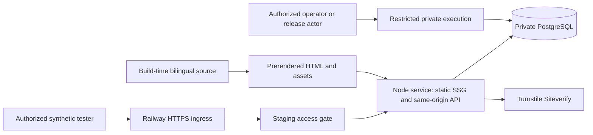

# Architecture Change Impact Assessment — KEN Elevators staging

**Date:** 2026-10-13
**Branch:** `001-phase1-lead-foundation`
**Source HEAD:** `bb85a0e8aeea45002e486ea46362f9c51b0829f3`
**Status:** Assessment and proposed documentation migration only. The user has explicitly selected Docker + Railway + PostgreSQL + a secure Node.js API for staging. Existing governing specifications have not yet been amended. This document neither deploys that choice nor grants production, real-data or stakeholder acceptance.

## 1. Recommendation and authority

Keep React Router framework-mode **explicit SSG with `ssr:false`**, React/TypeScript/Vite/Tailwind, typed bilingual source and the existing browser inquiry contract. Serve the generated frontend and `/api/v1/` from one stateless Node service in Docker on Railway, using a private PostgreSQL service. Retain Cloudflare Turnstile server verification. Retain the current pending notification-attempt ledger as a transactional outbox, drained through restricted operational execution in Phase 1. No separate queue, Redis, customer accounts, ORM, Express server or always-running notification worker is required.

The current user instruction authorizes the staging direction and this assessment. It does not authorize changing the PRD/constitution now, installing a PostgreSQL driver, implementing source files or provisioning Railway. Do not request another decision on the already-selected staging platform; the next work is a specifically authorized documentation migration and recording any required owner/legal/operational decisions.

The prior T003 GO applied to the previous consistent baseline. This assessment is **GO for preparing the documentation migration**, **NO-GO for adopting the changed backend/deployment under the unchanged governing documents**, and **NO-GO for hosted acceptance or production**. After the documentation migration and a fresh consistency analysis, the first implementation milestone is the bounded, architecture-independent T003 scaffold described in section 8.

### Governing conflicts requiring a recorded resolution

| ID / severity | Existing authority | Conflict and exact resolution needed |
|---|---|---|
| AC-01 — CRITICAL if adopted without resolution | Constitution II; Architecture and Release Constraints runtime/leads/environments rows | Hosting MUST use Cloudflare Pages/Pages Functions and D1 MUST store inquiries/attempts. Add an approved, staging-specific Railway/Node/PostgreSQL boundary or an explicitly approved, dated exception with rule/rationale/alternatives/owner/expiry. The preferred route is a separate constitution amendment, not silent reinterpretation. |
| AC-02 — CRITICAL if adopted without resolution | Constitution VII and operations/acceptance references | D1 is explicitly authoritative for lead totals. Specify PostgreSQL as authoritative **for migrated staging** while preserving durable acceptance, exactly one inquiry, immutable replay and recoverable notifications. |
| AC-03 — HIGH | PRD identity/scope/dependencies; P0-F005/P0-F007; §§8–11, 12–16 | Pages/D1/Functions deployment, storage, backups, operational telemetry and several acceptance clauses name Cloudflare. An approved staging addendum/amendment must delimit those requirements. Do not globally replace production clauses or claim Railway staging satisfies D1-specific production acceptance. |
| AC-04 — HIGH | spec FR-013/021, entities, SC-004/009; inherited architecture; plan/model/contracts/runbooks | Existing Phase 1 acceptance explicitly requires hosted D1/Pages. Amend provider-specific wording, test fixtures, source interfaces and evidence gates while preserving the user journeys and wire contract. |
| AC-05 — HIGH | Constitution VI/VIII; DEP-04/07/10/11/12 | Railway region, private jobs, access roles, log completeness/retention, backup locations and processor/network metadata have not been approved or demonstrated. A chosen platform is not legal clearance or operational readiness. |
| AC-06 — HIGH | Production scope and PRD release requirements | Production hosting remains a separate decision. Railway/PostgreSQL staging creates potential staging/production parity risk if a different production stack is later chosen; reserve an explicit production architecture and parity assessment gate. |

No conflict requires weakening Arabic-first parity, SSG/SEO, security, reliability, accessibility, performance, content honesty or public-release approvals. Under constitution Governance, replacing an incompatible MUST platform restriction warrants a proposed **MAJOR** version change, subject to project-owner approval in the separate amendment. A narrow approved exception instead must follow the existing exception procedure. No version or approval is changed here.

Required authorities remain project owner/KEN Management and Product Owner for architecture/scope/schedule, Engineering for implementation feasibility, QA for evidence/profile, and Legal/Operations for processing/retention/access. This report does not presume the current user's stakeholder role or fabricate sign-off. A proposed 2026-10-23 Phase 1 date must be reassessed; no revised delivery estimate is claimed.

## 2. Rendering, bilingual delivery and topology

React Router supports prerendered HTML and navigation data deployed through a static server with runtime SSR disabled. Its prerender configuration must be explicit; `ssr:false` alone is SPA mode, and route actions/runtime headers are not available in that configuration. Keep the inquiry API separate from Router route actions. [React Router prerendering](https://reactrouter.com/how-to/pre-rendering)

Proposed application decisions:

- Keep `build/client` as the frontend output and one authoritative root/entry/route system. T003 owns the minimal scaffold; T018 evolves the same files. Do not enable runtime SSR just because Railway can run Node.
- Keep all 14 Phase 1 localized documents: 12 primary URLs, including eight honest preparation documents, plus two privacy documents. Source modules provide initial content; no build or initial navigation depends on a public content API or PostgreSQL lookup.
- Preserve `lang="ar" dir="rtl"` and `lang="en" dir="ltr"` in initial HTML, page-preserving locale switching, six stable service choices and safe quotation query context. Preserve reviewed translations and the existing responsive/manual matrix.
- Keep self-canonicals, reciprocal hreflang, title/description/H1, safe social metadata and query-free canonicals based on an actual approved staging BUILD_ORIGIN. No invented production domain.
- Map extensionless URLs explicitly to emitted HTML; preserving the current flattened leaf layout is feasible. Retain Router-generated `.data` and hydration assets. A Node static manifest must handle exact known documents/assets, safe path normalization and GET/HEAD without directory listing, traversal or exposure of private files.
- Implement `/` → `/ar/` as a 302 for staging. Unknown English/Arabic URLs return the corresponding localized **HTTP 404**; unsupported locale defaults to Arabic with an English option. Never use a generic SPA-200 fallback.
- Replace Pages `_headers`, `_redirects` and `_routes.json` semantics with an explicit, build-derived private HTTP policy/route manifest interpreted by Node. Railway does not make Pages directive files active. Apply final hydration-script CSP hashes/minimal Turnstile origins and appropriate static/API security headers.
- Serve precompressed assets with correct content type/content encoding/Vary and an explicit cache policy. Staging protection must apply before asset delivery; protected HTML is private/no-store, and any asset caching must not bypass access control. Keep noindex metadata/headers and robots disallow; these do not provide confidentiality.
- Preserve the design-direction palette/font proposals, five-section Home, six choices/project status and static hero/120–180ms feedback. No door/camera/parallax/video/WebGL or new motion package enters this migration. Rights/native/visual approvals remain pending.

This is one application service plus one database service, with restricted migration/operations execution. Private jobs are not public endpoints. Railway private networking is environment-isolated and uses encrypted inter-service tunnels; it does not itself authenticate staff or approve data location. [Railway private networking](https://docs.railway.com/networking/private-networking)

## 3. Secure Node API and PostgreSQL design

### 3.1 Runtime and request boundary

Use Node **24.21.0**, npm **11.19.0**, TypeScript and a small `node:http` transport adapter around the existing shared validation/service modules. Native Node is a recommendation for this small surface, not an implemented security claim. Its streaming HTTP interface and server timeout controls support bounded handling; the application must supply routing, validation and safe error behavior. [Node 24 HTTP documentation](https://nodejs.org/docs/latest-v24.x/api/http.html)

Proposed files are `server/http/index.ts`, `server/http/static.ts`, `server/http/api-boundary.ts`, `server/db/pool.ts` and `tsconfig.server.json`. Compile server ESM separately with Node-compatible resolution/output; frontend bundler settings must not silently determine Node imports. No server/ops/database module may enter the client bundle.

Preserve the exact inquiry sequence:

1. Staging access gate, trusted deployment identity, configured host and server-generated correlation UUID.
2. Method/origin/media guards and verified ingress identity. Same-origin `POST /api/v1/inquiries`; no wildcard CORS or stored-lead read/list/update endpoints.
3. Claim both PostgreSQL quotas **before application body reading/JSON parsing**; include eligible malformed, oversized, later-invalid and replay requests once.
4. Stream-cap at **32,768 UTF-8 bytes**, independently of Content-Length; apply the complete existing allowlist/Unicode/type/enumeration/field-boundary rules.
5. Fresh server Turnstile verification, exact action/hostnames, existing five-second attempt timeout and bounded token-scoped network retry.
6. Retained identity classification, new-only current-notice rule and atomic durable acceptance.
7. Return only the existing safe acceptance/error bodies, no-store/correlation/Retry-After as applicable.

Keep 201 new, 200 immutable replay, 409 changed retained content and 400/403/413/415/429/500-safe/503 failure semantics. Unsupported resource methods remain 405/Allow and unknown API child resources generic JSON 404. The public API stays account-free after passing the staging transport gate. Document staging gate 401 responses separately; do not add customer JWTs or a User table.

The transport adapter needs tested body/header/connection deadlines, bounded pool queue and concurrency, shutdown/draining, rejected-body connection handling, checkContinue behavior, duplicate/malformed transport headers and safe parser-error handling. No global JSON middleware may read a body before the quota gate. PostgreSQL/Turnstile timeouts fail closed. Never log raw Request/Error/pg errors, SQL parameter values, connection URLs, authorization headers, tokens or payload/key/network digests.

Railway documents `X-Real-IP` and forwarding headers, but the overwrite/duplicate/proxy-chain trust boundary must be proven on the actual ingress. Do not carry over `CF-Connecting-IP`, trust arbitrary X-Forwarded-For, or treat a forwarded hostname as authorization. Test forged headers, private-network entry and every alias; missing trustworthy identity denies inquiry intake. Use configured origins rather than user-controlled forwarding values to generate links. [Railway networking specifications](https://docs.railway.com/networking/public-networking/specs-and-limits)

### 3.2 Schema and authority

Recommend a supported **PostgreSQL 18** staging candidate, with the exact provider image/build/version policy resolved before installation/provisioning. Do not use a beta, assume a template's current default or claim an exact patch/digest has been checked. PostgreSQL's current stable documentation and Railway's supported major-image requirements include 18. [PostgreSQL documentation](https://www.postgresql.org/docs/current/transaction-iso.html), [Railway supported PostgreSQL images](https://docs.railway.com/databases/postgresql-ha)

| Existing entity / concern | Proposed PostgreSQL representation |
|---|---|
| inquiries | UUID primary/reference ID; millisecond-precision timestamptz creation/consent; normalized text fields; constrained locale/type/service/building values; Boolean server-set test_record; unique idempotency digest; versioned payload HMAC; received status |
| notification_attempts | UUID IDs/FK with authorized lifecycle cascade; unique inquiry_id/attempt_number; existing mode/status/history/eligibility/error fields; timestamptz deadlines; UUID lease fence |
| rate_limit_buckets | HMAC network digest, constrained window kind, UTC window start, bounded count, expires_at and composite uniqueness |
| Migration bookkeeping | Explicit schema_migrations version/checksum ledger and one serialized migration owner; no D1 provider-managed migration assumption |
| Environment/notice policy | Small private metadata/policy record containing expected staging identity and current notice version; no personal data or new public config endpoint |

Keep meaningful CHECKs/indexes, quotation-only fields, no raw idempotency key/IP/token, and no unnecessary phone/email search index. PostgreSQL is authoritative for **staging** inquiry totals. Keep API UTC ISO-8601 formatting and original timestamp replay stable; do not accidentally expose driver-specific Date/precision/time-zone changes. Translate the SQLite/D1 migrations rather than running them unchanged. Content remains typed source; no CMS or public-content database is added.

Use a single writable primary for correctness-sensitive acceptance; no read-replica replay lookup. Limit aggregate connections across replicas, rolling-release overlap, migration/ops and tests. Validate query/lock/connection timeouts against actual account limits.

### 3.3 Transactional idempotency and notice rollover

Keep the existing canonical lowercase UUID, environment-scoped SHA-256 identity and fixed-order versioned payload HMAC, including notice/locale and excluding token/idempotency key. Old HMAC keys remain usable for matching retained inquiries. Identity lifetime remains inquiry retention, not an arbitrary 24-hour cache.

**Proposed algorithm, to verify in T036/T043:** after all independent controls, obtain one pool client and begin a short READ COMMITTED transaction. Read a retained identity first. An identical payload under its stored hash version returns the original reference/time; changed valid content returns 409 without mutation or notification. For a miss, read/lock the authoritative staging notice-policy row for new acceptance. Stale new notice performs a final winner lookup or returns 400/notice_changed. Only a current-notice miss can attempt insertion.

Use parameterized `INSERT ... ON CONFLICT DO NOTHING RETURNING`. A winner inserts the inquiry and sequence-one pending outbox row **in the same transaction**, then commits before 201. A loser performs a **separate SELECT statement** and compares the committed winner, yielding 200 or 409. Do not update consent/content merely to obtain a result; do not infer race safety from a preliminary lookup or process-local mutex. A policy shared lock prevents a concurrent notice change during a new commit; a serialized notice update must coordinate old/new app versions.

READ COMMITTED uses successive statement snapshots, and a uniqueness conflict can suppress insertion even when the conflicting row was outside the INSERT snapshot. That is why a one-statement CTE fallback cannot be assumed to reveal the winner. All statements must use the same checked-out pg client. [PostgreSQL isolation semantics](https://www.postgresql.org/docs/current/transaction-iso.html), [node-postgres transactions](https://node-postgres.com/features/transactions)

If outbox insertion fails, roll back the inquiry. Connection loss during COMMIT is an unknown outcome, never a claim that zero rows exist or permission to rotate identity. Return safe retry guidance; retry the same key with a fresh challenge. Bound deadlock/lock-timeout handling; do not indefinitely retry or repeat external verification/dispatch inside a transaction.

Retain all A → B tests: accepted A/lost response/current B/unchanged A concurrent case-variant retries → 200/original time/unchanged consent/one inquiry/one initial pending row; changed retained payload or notice → 409; new A → 400/notice_changed; new B → 201. Add overlapping-release, rollback, deadlock/timeout and policy-lock tests.

### 3.4 Outbox, recovery and quotas

Use **notification_attempts itself as the outbox**. A committed pending sequence-one record is durable work, not delivery success. Phase 1 retains labeled simulation and authorized attended operational drain/replay; replacing waitUntil does not require adding a broker, hosted scheduler or permanent worker. A future automatic worker is a separate explicit decision.

The restricted dispatcher claims eligible work in a short transaction, commits running state/120-second lease/fencing UUID, performs simulation outside the transaction, then writes the result only while its lease still owns the attempt. Row locks and SKIP LOCKED can distribute eligible work; preserve unique sequence creation and lock the inquiry/latest-attempt boundary when creating the next attempt. The claimed row must leave pending state before locks are released. SKIP LOCKED is appropriate to queue-like work, not the authoritative inquiry replay decision. [PostgreSQL row-locking clauses](https://www.postgresql.org/docs/current/sql-select.html)

Preserve one-minute/five-minute eligibility, maximum three attempts then escalation, explicit corrected recovery, immutable history, stale lease fencing and orphan discovery. No replay creates an inquiry. Notification outcome cannot negate visitor acceptance. Any later external email delivery is at-least-once under crash uncertainty; provider acceptance is not exactly-once inbox receipt.

For quotas, use conditional PostgreSQL UPSERTs with RETURNING and deterministic window lock order. Commit quota accounting in a **separate short transaction before body read**, even when the second window refuses; the consumed first-window charge is not refunded. Rollback on a database/control failure returns 503 with no lead. Keep 10/10 minutes and 50/UTC day, fixed-window boundary/shared-network tradeoffs, HMAC day rotation, expiry and Retry-After. Never keep quota accounting inside the later acceptance transaction or malformed requests would escape accounting through rollback.

## 4. Docker and Railway staging responsibilities

### 4.1 Build, service and release boundary

- T006 owns Dockerfile, compose.yaml, .dockerignore and railway.toml; these are proposed outputs, not files created by this assessment. Compose is local/test orchestration. Railway maps services individually; it does not execute a local Compose file as a deployment contract. [Railway Compose mapping](https://docs.railway.com/guides/docker-compose)
- Use a Debian-based multi-stage Node image, exact Node/npm compatibility and reviewed application image digest. Build with the locked dependency set; runtime contains generated client/server outputs and required runtime dependencies, not development/test/evidence material. Run as non-root, with a read-only application filesystem where feasible, bounded scratch space and a direct signal-aware Node entrypoint. [Docker multi-stage builds](https://docs.docker.com/build/building/multi-stage/)
- Exclude host node_modules, .git, private env files, database volumes/dumps, credentials, evidence and unrelated agent/config directories from Docker build context. Curated build inputs may include only required build-time contract fixtures. No secrets in Docker ARG, image layers, frontend prefixes or build logs; approved build secrets need transient mounts. [Docker build secrets](https://docs.docker.com/build/building/secrets/)
- Railway detects Dockerfiles and permits explicit Dockerfile paths; the application root remains my-project, the repository root remains its parent. Configure root/build context explicitly. Only public, reviewed build values such as BUILD_ORIGIN/site key may enter frontend build configuration. [Railway Dockerfiles](https://docs.railway.com/builds/dockerfiles)
- One stateless application service serves SSG + API on the assigned PORT. PostgreSQL has its own persistent volume/private service; never put the database on the application filesystem. Keep application/DB in one reviewed region for staging and disable app sleeping during measured tests/monitored intake. No HA/uptime claim follows from single-node staging.
- GitHub quality remains read-only/secret-free for untrusted forks. Trusted release follows successful mandatory checks, image scan, approved target/schema compatibility and staged migration result. Use staging-scoped credentials, exact project/environment/service/image/source IDs, concurrency and full-SHA Actions. Disable any auto-deploy path that bypasses that gate. Do not create a production service or auto-deploy from this branch.

### 4.2 Secrets, private execution and access

Railway variables are available to builds and runtime; sealed variables are not returned through the UI/API and have cloning/CLI limitations. Sealing does not protect secrets from code running with them or eliminate the need to keep builds/logs clean. Record recovery/rotation and provide staging-specific credentials deliberately. [Railway variables](https://docs.railway.com/variables)

Names-only proposed contracts include PORT, NODE_ENV, APP_ENV, expected Railway project/environment/service IDs, expected database identity, DATABASE_URL, approved database TLS trust material, BUILD_ORIGIN, allowed hosts/origins, intake/simulation controls, Turnstile settings, HMAC versions and staging tester-gate configuration. Migration and operator credentials belong only to their separate private execution surface. No real values belong in this document or Git.

Use SQL roles separating API acceptance/rate operations, migration DDL, safe monitoring/reconciliation projections, deliberate lead retrieval, notification replay and approved cleanup. The runtime must not use postgres superuser credentials or receive migration credentials. Public health and monitoring projections reveal no personal data. Choose the actual private execution/secure-output method before writing usable remote commands: `railway run` supplies variables to a local process and must not be assumed to tunnel into the private network.

A dedicated private migration job/execution identity is preferred. Railway pre-deploy commands can reach private networking and fail a release, but run with application variables and without mounted volumes; that convenience alone does not separate DDL credentials from the runtime. Verify a dedicated migration-service/job mechanism or document an approved alternative. Use a PostgreSQL advisory migration lock, checksum ledger and bounded migration timeout. Never run migrations on every API startup/replica. [Railway pre-deploy behavior](https://docs.railway.com/deployments/pre-deploy-command)

Keep PostgreSQL private without a public TCP proxy. Railway's PostgreSQL template supplies a database service, not proof that a selected plan provides approved backup, upgrade or access arrangements. Record provider/application maintenance ownership. [Railway PostgreSQL](https://docs.railway.com/databases/postgresql)

Require provider MFA, named primary/backup access and tested unauthorized rejection. Railway platform roles can be broader than SQL roles; environment-scoped controls must be checked against the actual plan. A private dashboard/project does not protect the hosted website. [Railway workspace roles](https://docs.railway.com/projects/workspaces)

Recommend an application-level **staging-only HTTP Basic tester gate** as the minimal provider-independent candidate, with individually provisioned strong credentials, constant-time verification, rotation/revocation, secret-safe logs and blanket protection of static/API/aliases. This is restricted tester access, not customer account functionality. An approved external identity proxy is an alternative if organizational policy requires it. Neither is implemented/approved here. Fail closed if the gate is missing; exempt only a reviewed minimal health probe, never a wildcard/API subtree. Test direct default and custom Railway domains, internal entry and any future preview alias; remove unneeded aliases.

Use encrypted private transport and verify the PostgreSQL TLS/authentication configuration. Prefer validated certificates/trust material; do not solve connectivity by blanket disabling certificate verification. URL SSL options can override pg TLS settings, so test actual effective configuration and reject ambiguous combinations. An unattainable provider trust configuration needs an explicit security decision. [node-postgres TLS configuration](https://node-postgres.com/features/ssl)

### 4.3 Health, shutdown and monitoring

Keep the existing `GET /api/v1/health` wire schema: HTTP 200/status=ok or 503/status=unavailable, only correlationId/status and no-store. A bounded readiness probe checks required configuration, database reachability/expected identity and compatible schema; it does not call Turnstile for every probe or expose bindings/version/counts. Add internal process-liveness/shutdown checks only if needed, without a public diagnostics surface.

Listen on Railway's PORT and allow its healthcheck host **only for the minimal probe**. Railway's healthcheck gates initial activation; it is **not continuous monitoring** after deployment. A data-backed volume service can also have deployment downtime despite healthchecks. Independent monitoring and Node SIGTERM draining/pool closure remain necessary. [Railway healthchecks](https://docs.railway.com/deployments/healthchecks)

Preserve the operational contract:

- Rolling 15-minute total N and 5xx E; E/N >1% for any N>0, with no invented minimum denominator.
- Complete unsampled status coverage of all API routes/rejections/aliases and edge/platform failures, acquisition lag ≤60 seconds, evaluation ≤60 seconds and reporting ≤120 seconds under that complete-source contract.
- Notification unresolved age ≥15 minutes or three consecutive failures/15 minutes; retries do not reset age. Existing dedup/reset/reopen/60-minute escalation and one-business-day handoff remain.
- Attended synthetic intake, independent backup heartbeat review ≤2 minutes, failed/stale feed as insufficient data, and denial of intake without required coverage.
- Approved private safe projections/receipts/state retention; local cleanup cannot claim provider-side deletion.

Railway has HTTP request logs with status/timestamps and sensitive network fields. This creates a **candidate** source, not demonstrated completeness, acquisition latency, pagination or plan permissions. T028/T075 must validate the exact export/CLI/API interface and all aliases. A partial live-tail or application-only log cannot replace the complete denominator. Platform logs may retain network metadata and use plan-dependent retention; review that processing separately. [Railway logs](https://docs.railway.com/observability/logs), [Railway log acquisition](https://docs.railway.com/cli/logs)

Keep only safe application categories/status/timing/correlation. Join platform records only through a validated bounded private correlation projection if necessary; do not trust inbound request IDs as application IDs. Review PostgreSQL statement/parameter-error logging and Railway tracing defaults to avoid copying contact values into telemetry. No RUM/analytics collector or unapproved observability service is added. Missing feed capability blocks hosted monitoring, requiring a recorded alternative rather than threshold weakening.

### 4.4 Backups, regions and lifecycle

Railway's documented regions are outside Saudi Arabia; no selected region or private network proves Saudi residency, PDPL compliance or acceptable transfers. Legal review must cover Railway/underlying processors, registry/CI artifacts, PostgreSQL volumes, logs, staff, Turnstile and every backup destination before dependent hosted processing. Synthetic fields do not eliminate tester network metadata. [Railway regions](https://docs.railway.com/deployments/regions)

For staging, approve a synthetic fixture/backup/evidence policy, a pre-migration recovery point and a restore rehearsal into an isolated synthetic database before relying on backups. Record connection cutover and reconciliation; routine app rollback uses a prior compatible image, never reverse/drop SQL or restoration over current leads.

Provider volume snapshots, PostgreSQL PITR and encrypted logical exports are separate mechanisms. Railway volume schedules/retentions do not automatically equal the proposed daily encrypted 30-day independent backup policy; restorations and surviving old snapshots must be included in deletion review. [Railway volume backups](https://docs.railway.com/volumes/backups)

Railway documents PostgreSQL PITR with archived WAL/base backups and a new sibling database restore; actual activation, usable recovery range, archive lag, bucket credential rights, region and cost must be verified. Its PITR image policy does not support fixed minor-version pinning: decide explicitly between supported provider-maintained major images with recorded running versions, and a separately maintained/pinned database with an alternative recovery design. This does not loosen the application dependency/image pins. [Railway PITR](https://docs.railway.com/volumes/point-in-time-recovery)

Approved logical exports must be encrypted before leaving the controlled execution destination; a pg_dump is not encrypted merely because it originated from an encrypted volume. Restrict restore/export keys, roles and destinations; monitor backup failure and test pg_restore/schema/count/replay integrity. RPO/RTO, retention and destruction of backup/history copies remain owner decisions. **12-month lead retention and 30-day daily backups remain proposals, not adopted policy.**

Production architecture, real-data processing, live email, full genuine content/gallery/contact/domain, restore/rollback drills and KEN launch authorization remain independently blocked. Staging approval must explicitly grant none of these.

## 5. Exact task impact: preserve IDs and acceptance strength

All **117** original IDs are preserved. T001/T002 remain completed; T003–T117 remain unchecked. The assessment classifies the remaining **115** tasks as **27 Rewrite**, **44 Adapt**, **44 Reusable**:

- **Rewrite:** T005–T006, T019, T022–T024, T028, T030–T031, T034, T036, T040–T041, T043–T044, T054, T064, T066–T071, T075, T094, T107, T110.
- **Adapt:** T007–T008, T020–T021, T025–T027, T029, T032, T045, T050, T052–T053, T055–T058, T060–T063, T072–T074, T076–T078, T093, T095–T099, T101–T102, T106, T108–T109, T111, T113–T117.
- **Reusable:** T003–T004, T009–T018, T033, T035, T037–T039, T042, T046–T049, T051, T059, T065, T079–T092, T100, T103–T105, T112.

“Rewrite” changes technology/owned outputs. “Adapt” retains the substantive goal but changes harness, target, evidence or approval criteria. “Reusable” keeps task intent/paths/acceptance logic; it is not a claim of implemented code and still runs after its original or explicitly migrated prerequisites. The mapping covers every T003–T117 exactly once.

| Task | Impact | Required migration or reuse |
|---|---|---|
| T003 | Reusable | Retain the self-contained Router/Vite/Tailwind SSG scaffold, existing pins and T018 handoff; first implementation milestone only. |
| T004 | Reusable | Reuse formatting, lint and browser/server import-boundary rules; include new server paths when authored. |
| T005 | Rewrite | Replace Cloudflare runtime harness with Node plus real isolated PostgreSQL; own reviewed pg/type pins and migration-toolchain evidence. |
| T006 | Rewrite | Replace Wrangler/.dev.vars configuration with Dockerfile, compose.yaml, .dockerignore, railway.toml, Node server tsconfig and strict environment/target configuration. |
| T007 | Adapt | Extend evidence schema with staging platform, image digest, PostgreSQL version/schema identity and migration-decision references. |
| T008 | Adapt | Add pending Node start/build, container, PostgreSQL migration/test and private-ops interfaces; keep missing implementations nonzero. |
| T009 | Reusable | Reuse typed approval-aware content/public projection models. |
| T010 | Reusable | Reuse all shared enums and safe API types. |
| T011 | Reusable | Reuse paired dictionaries and honest fixture/approval states. |
| T012 | Reusable | Reuse 14-route manifest, locale switching and safe quotation context. |
| T013 | Reusable | Reuse locale/query/UI-contract tests. |
| T014 | Reusable | Reuse content, route and OpenAPI validation; update only contract metadata after approval. |
| T015 | Reusable | Reuse proposed design tokens, RTL/LTR typography and motion defaults. |
| T016 | Reusable | Reuse semantic reusable UI primitives and states. |
| T017 | Reusable | Reuse navigation, privacy utility, skip link and mobile focus behavior. |
| T018 | Reusable | Reuse localized root/routes/templates and removal of T003 scaffold; no runtime SSR. |
| T019 | Rewrite | Replace Pages directive output with a private HTTP policy/static manifest and minimal Node static listener; retain 14 SSG documents and .data assets. |
| T020 | Adapt | Retarget header/secret/budget audits and Lighthouse runner to the Node/container host; retain every threshold and failure fixture. |
| T021 | Adapt | Exercise the actual Node container host, header policy, refresh/404/data assets and inert Turnstile fixtures. |
| T022 | Rewrite | Implement Node configuration, bounded pool adapter, readiness, safe logging and headers; enhance the T019 listener without a second server. |
| T023 | Rewrite | Translate SQLite/D1 SQL into PostgreSQL migrations, constraints, indexes, role grants, migration ledger and environment/notice policy. |
| T024 | Rewrite | Test fresh/upgrade PostgreSQL schemas, grants and constraints against a real isolated database; no SQLite substitute. |
| T025 | Adapt | Adapt CI to Node/container delivery and isolated PostgreSQL services, image scanning and Linux native-tool evidence; retain secret-free fork jobs. |
| T026 | Adapt | Record the Node/Docker/PostgreSQL local foundation checkpoint; later API/widget/hosted suites stay pending. |
| T027 | Adapt | Review Railway/registry/PostgreSQL/Turnstile/tester network processing and synthetic fixture/evidence policy. |
| T028 | Rewrite | Provision only authorized Railway staging application/DB/private execution resources; verify region, plan, backup/log/access capabilities and real Turnstile. |
| T029 | Adapt | Review staging-scoped Railway deploy credentials, GitHub environments, image registry and serialized migration/release authority. |
| T030 | Rewrite | Replace Access assumptions with an approved staging gate covering every Railway/default/custom/preview alias, runtime secrets and host allowlists. |
| T031 | Rewrite | Replace Wrangler migration/Direct Upload with private, serialized PostgreSQL migration execution and health-gated Railway container release. |
| T032 | Adapt | Prove actual Railway HTTPS/protection/14 routes/true 404s and staging-only database targets. |
| T033 | Reusable | Reuse exact schema/phone/UUID/notice boundary test definitions. |
| T034 | Rewrite | Replace D1/Cloudflare controls harness with Node streams, trusted Railway ingress, PostgreSQL quota races and network-fault tests. |
| T035 | Reusable | Reuse API wire-level status/header/confidentiality/health assertions; fixture transport is supplied by migrated harness. |
| T036 | Rewrite | Port persistence/race tests to real PostgreSQL; preserve notice A-to-B, UUID case, unknown commit, rollback and exact row-count assertions. |
| T037 | Reusable | Reuse bilingual form/widget lifecycle assertions including Check form and notice snapshots. |
| T038 | Reusable | Reuse pure normalization, E.164 phone parsing and Zod allowlist. |
| T039 | Reusable | Reuse canonical lowercase UUID, environment key hash and versioned payload HMAC rules. |
| T040 | Rewrite | Replace Cloudflare identity and Request transport adapters with strict Node streaming and verified Railway X-Real-IP ingress handling. |
| T041 | Rewrite | Replace D1 batch quotas with committed PostgreSQL capped UPSERT transactions in deterministic lock order, before body read. |
| T042 | Reusable | Reuse server-side Siteverify, action/hostname, five-second timeout and bounded token-scoped retry contract. |
| T043 | Rewrite | Use one PostgreSQL client/transaction for immutable conflict/replay classification and atomic inquiry plus initial outbox insertion. |
| T044 | Rewrite | Replace functions/ exports and _routes.json with the Node HTTP API composition on the existing listener; complete health contract and shutdown handling. |
| T045 | Adapt | Run PostgreSQL/Node contract checkpoint with all original rejection, race, rollover, confidentiality and failure cases. |
| T046 | Reusable | Reuse widget lifecycle and public-only site-key boundary. |
| T047 | Reusable | Reuse fetch client/state machine, immutable unknown-outcome snapshot and retry identity. |
| T048 | Reusable | Reuse both form modes, accessible validation/focus and privacy acknowledgement. |
| T049 | Reusable | Reuse Contact integration and safe post-hydration context. |
| T050 | Adapt | Retarget real local fetch/retry browser scenarios to the Node container and isolated PostgreSQL fixture-count queries. |
| T051 | Reusable | Reuse confidentiality cases; new harness supplies real Node/PostgreSQL transport. |
| T052 | Adapt | Record local Node/PostgreSQL US1 results and all four locale/mode combinations; no hosted claim. |
| T053 | Adapt | Review Railway targets, privacy/notice/hash/Turnstile settings, ingress trust, quota policy and authorized alias fault windows. |
| T054 | Rewrite | Replace Pages Functions deployment with a reviewed immutable Railway application image and private migration release. |
| T055 | Adapt | Verify the actual Railway-hosted widget, CSP and server Siteverify; local test keys remain separate. |
| T056 | Adapt | Match all four submission references to exactly one PostgreSQL inquiry and sequence-one pending row through fresh restricted access. |
| T057 | Adapt | Repeat hosted immutable retry, notice rollover, UUID case and conflicting payload tests on Railway/PostgreSQL. |
| T058 | Adapt | Repeat protected alias rejection/flood/quota/storage faults with Railway ingress and PostgreSQL; retain zero-insert assertions. |
| T059 | Reusable | Reuse bilingual form/manual/privacy interaction review. |
| T060 | Adapt | Verify actual Node HTTP status/body/headers, health pairings and no public stored-lead operations. |
| T061 | Adapt | Accept US1 only against the amended staging contract and actual Railway/PostgreSQL evidence. |
| T062 | Adapt | Retarget lease/interruption/state tests to PostgreSQL and real Node process termination; retain existing timing and recovery semantics. |
| T063 | Adapt | Retarget wrong-target/auth/cleanup/monitor tests to Railway/private execution and PostgreSQL roles/identity; retain every alert boundary. |
| T064 | Rewrite | Implement PostgreSQL row locks, unique attempt sequencing, committed leases and token-fenced result writes. |
| T065 | Reusable | Reuse restricted configuration-controlled labeled notification simulation. |
| T066 | Rewrite | Replace waitUntil with a restricted post-commit outbox-drain dispatcher; operator replay owns execution, never request-lifetime durability. |
| T067 | Rewrite | Replace Wrangler/D1 target/reconciliation access with private PostgreSQL execution and server-verified staging identity. |
| T068 | Rewrite | Implement restricted PostgreSQL reference retrieval with named role, deliberate private destination and safe output transport. |
| T069 | Rewrite | Implement PostgreSQL replay sequencing/leases and authorized post-escalation recovery; no duplicate inquiries. |
| T070 | Rewrite | Port scoped fixture/rate cleanup and reviewed private evidence expiration to PostgreSQL/private execution; refuse production. |
| T071 | Rewrite | Replace Cloudflare request-status acquisition and D1 summaries with verified Railway edge projections and PostgreSQL state queries. |
| T072 | Adapt | Rewrite relevant runbook/quickstart sections for private jobs, PostgreSQL roles, host protection, monitoring and rollback. |
| T073 | Adapt | Run local PostgreSQL outbox/recovery/private-ops regressions with original fault matrix and counts. |
| T074 | Adapt | Demonstrate named primary/backup Railway access/MFA and separate SQL-role capability; do not infer per-table rights from platform membership. |
| T075 | Rewrite | Select and prove the actual Railway status-feed interface, completeness/latency/retention, safe routing and attended monitoring coverage. |
| T076 | Adapt | Demonstrate actual hosted PostgreSQL failure/interruption/replay and safe operator access under the trusted release workflow. |
| T077 | Adapt | Prove complete Railway denominator, original alert thresholds/cadence, stale feed, heartbeat, reset/reopen and one-day handoff. |
| T078 | Adapt | Accept US2 only with actual hosted recovery/monitor/access evidence; simulated notification still does not establish live email. |
| T079 | Reusable | Reuse token/component/CTA/fallback tests and palette contrast assertions. |
| T080 | Reusable | Reuse five-width bilingual navigation/resilience matrix. |
| T081 | Reusable | Reuse semantic marketing patterns and all six service choices. |
| T082 | Reusable | Reuse five-section Home content/design-state documentation. |
| T083 | Reusable | Reuse Sharp/media rights/derivative/budget pipeline. |
| T084 | Reusable | Reuse licensed local font, shaping/fallback and 120 KiB evidence. |
| T085 | Reusable | Reuse initial Home SSG composition and honest preparation states. |
| T086 | Reusable | Reuse verified contact helpers and unavailable-channel suppression. |
| T087 | Reusable | Reuse static hero and 120–180ms color/opacity-only scope. |
| T088 | Reusable | Reuse Home automated/axe/build-budget acceptance; prior-story regressions use migrated harness. |
| T089 | Reusable | Reuse actual keyboard/screen-reader/contrast/reflow/motion review. |
| T090 | Reusable | Reuse proposed brand/wireframe/font approval gate. |
| T091 | Reusable | Reuse independent native bilingual visible-copy/metadata/privacy review. |
| T092 | Reusable | Reuse six US3 acceptance scenarios and existing review gates. |
| T093 | Adapt | Update deployment-policy fixtures for Docker images, Railway identities/aliases, private PostgreSQL and protected staging gate. |
| T094 | Rewrite | Replace Direct Upload with image build/scan, explicitly scoped Railway release and separate private migration execution after mandatory quality checks. |
| T095 | Adapt | Audit Node/container headers, image layers/context, PostgreSQL role boundaries, Railway secrets and all alias protections. |
| T096 | Adapt | Record actual image digest, source/schema versions, Railway URL/IDs and compatible migration/backup evidence for the candidate. |
| T097 | Adapt | Retarget hosted HTML/SEO/status/data-asset checks to the Node static adapter; retain all 14 routes and preview noindex. |
| T098 | Adapt | Retarget actual critical journey and stored-count/recovery proof to PostgreSQL; retain real Turnstile and four combinations. |
| T099 | Adapt | Prove all Railway/default/custom aliases and private-network/data/secret isolation; no reliance on dashboard project privacy. |
| T100 | Reusable | Reuse actual two-major browser/device and contact-launch evidence matrix. |
| T101 | Adapt | Freeze actual Railway/Node/Linux runner profile and authenticated-page measurement; resolve privacy accessibility run-count/aggregation explicitly. |
| T102 | Adapt | Run the unchanged Lighthouse assertion contract on Node/Railway targets, preserve Turnstile costs and sanitize tester credentials from reports. |
| T103 | Reusable | Reuse critical-content/interaction traces and INP-versus-TBT distinction. |
| T104 | Reusable | Reuse synthetic usability planning and participant gates. |
| T105 | Reusable | Reuse measured completion, timing and trust thresholds. |
| T106 | Adapt | Rehearse rollback to a prior compatible image while PostgreSQL data/outbox survive; never reverse schema or restore DB as routine rollback. |
| T107 | Rewrite | Replace D1 Time Travel/export review with verified Railway snapshots/PITR/logical export, encryption/location/deletion and synthetic restore feasibility. |
| T108 | Adapt | Reconcile architecture authorization, changed DEP gates, provider/SQL roles and separate unresolved production decision. |
| T109 | Adapt | Base preview-ready status on actual amended Railway/PostgreSQL candidate and unchanged quality/approval gates. |
| T110 | Rewrite | Rewrite and verify local Compose/Node/PostgreSQL and restricted Railway execution quickstart; never default to a hosted target. |
| T111 | Adapt | Extend security review to container/image, Node lifecycle/parser/proxy trust, PostgreSQL privileges and Railway metadata processing. |
| T112 | Reusable | Reuse scope/honesty/deferred-feature review; production platform decision remains explicitly unresolved. |
| T113 | Adapt | Run all final Node/PostgreSQL/container checks plus existing build/browser/axe/performance/hosted requirements. |
| T114 | Adapt | Capture a scoped PostgreSQL cleanup receipt under the approved synthetic policy, preserving private non-sensitive evidence. |
| T115 | Adapt | Reconcile T001 original hashes with an explicit authorized migration baseline/delta; never overwrite history or falsely claim old hashes still match changed docs. |
| T116 | Adapt | Hand over Railway/PostgreSQL operations, backup/monitoring duties and unresolved production/real-data/later content gates. |
| T117 | Adapt | Record architecture-amended Phase 1 acceptance on exact image/source/schema/URL; no production or real-data permission. |

### Ownership and dependency changes to make concrete during migration

1. Add the approved migration decision/document-baseline/fresh-analysis entry gate before changed architecture work. T003 still depends on completed T002 and stays independently buildable.
2. T005 owns additive reviewed PostgreSQL driver/type resolution and Node/PostgreSQL harness; record `evidence/migration-toolchain.md`, not a rewrite of T002 evidence. T006 owns container/platform configuration. Make T006 acceptance depend on T005 for the runtime dependency/container interface. At Setup, validate only the builder/scaffold target and configuration; the final Node runtime image cannot pass until T019 owns its real listener, with complete container delivery tested by T021/T025. Missing later entrypoints remain explicit failures, never dummy-success files. Serialize package/lock edits; reconsider the current Setup parallel wave.
3. T019 owns the first **static-only** Node listener and private generated policy. T022 enhances that same listener with pool/config/readiness/security; add **T019 and T023** to T022's dependencies. T044 mounts the final inquiry/health composition later. No duplicate listener, future story import or fake successful API placeholder.
4. T023 owns the PostgreSQL migration ledger/roles/policy schema; T024 proves it locally. T025/T026 validate Docker/Node/PostgreSQL foundation only. Future widget/form suites stay pending.
5. T028/T029 establish actual private execution, registry/deploy/access capability. T030 protects all active aliases. T031 migrates/releases only after T026–T030. Separate migration-role credentials from runtime, and verify the chosen job mechanism before claiming this dependency satisfied.
6. Keep T026 → local inquiry, T032 → hosted inquiry, T052 → local recovery, T061 → hosted recovery, **T078 → Home decoration**, and T092/US1/US2 → full candidate gates. Local mocks cannot close hosted PostgreSQL/Turnstile/access/monitoring checks.
7. T115 must compare historical T001 sources plus an approved subsequent migration baseline, not require intentionally amended documents to reproduce old hashes. Preserve auditability of each authorized delta.
8. Recompute dependencies/cycles/parallel-wave safety and requirement coverage after actual documentation migration. No task dependency, parallel marker or phase gate is changed by this assessment.

## 6. Quality and Lighthouse migration preservation

Keep exactly pinned **lighthouse 13.5.0**; never reinstall vulnerable `@lhci/cli 0.15.1` as part of platform migration. The migration needs new targets/adapters, not new thresholds. The [existing runner handoff](evidence/toolchain.md#lighthouse-cli-migration-plan) remains authoritative.

Preserve T020/T101/T102: five independent cold runs for each Home/Contact locale, **20 reports**, validated JSON/config/route/tool/run-count checks, unrounded medians, Performance ≥90 and Accessibility ≥95 for required representative Home/Contact/privacy; LCP ≤2500ms, CLS ≤0.10 and separate budget enforcement. Runtime errors/missing reports/bad profiles/threshold failures must cause a nonzero CI exit; retain failing/incomplete-report fixtures and prohibit continue-on-error/success masking.

The privacy accessibility sample count/aggregation was left unspecified in the prior analysis. Recommend five runs **per privacy locale** as an explicit migration proposal, yielding ten additional accessibility reports, subject to T101 QA/Product Owner agreement. Do not silently call this approved or average templates/locales together.

| Budget retained | Home | Contact | Privacy/preparation |
|---|---:|---:|---:|
| First-party JS gzip | 150 KiB | 180 KiB | 150 KiB |
| CSS gzip | 30 KiB | 30 KiB | 30 KiB |
| Selected-locale WOFF2 actual bytes | 120 KiB | 120 KiB | 120 KiB |
| Mobile above-fold imagery | 200 KiB | 80 KiB | 80 KiB |
| Initial first-party total including HTML/data | 550 KiB | 450 KiB | 450 KiB |

Freeze actual Linux/container/Chrome/Node/Lighthouse runner, hardware, cache state and agreed 390×844/DPR1/4× CPU/150ms RTT/1600 down/750 up profile. Record compression and protected-page authentication behavior; measure the intended page, not an auth challenge, and do not exclude real hosted Turnstile costs. Tester authorization must stay in private runner configuration and be redacted from any report/settings/artifacts without changing numerical results. Canary tests must detect credential leakage.

Retain T103's two-second H1/CTA usability trace, applied-throttling interaction INP ≤200ms, no TBT-as-INP and no synthetic-as-field-p75 claim. Preserve axe/manual/native/five-width/real-browser-device and ≥10 usability gates. Current Windows native/browser tool evidence does not prove Linux container builds or actual Safari/mobile acceptance.

Add meaningful PostgreSQL transaction/race/role/policy/unknown-commit tests, Node body/parser/proxy/shutdown tests, container secret/context/image audits, restart/outbox fencing and actual Railway access/status-feed/backup/restore evidence. They supplement rather than replace existing invalid/duplicate/conflict/storage/notification/copy/accessibility cases. No test or build is executed here.

## 7. Preserve T001/T002 and installed work

The branch and HEAD are unchanged. The existing working tree is dirty from authorized T001/T002/Lighthouse work; do not reset, clean, switch branches, initialize another repository, restore files from HEAD or recapture a falsely clean baseline.

Read-only inspection for this assessment found **117 unique tasks, 45 parallel markers and only T001/T002 checked**. All **32** declared direct pins match installed package versions; the lock is v3 with **518** non-root entries and no @lhci entries. Node is 24.21.0; packageManager/npm pin is 11.19.0. Existing manifest/lock/graph hashes match the T002 recorded values:

| Item | SHA-256 |
|---|---|
| package.json | `99b451da0b61f75743c20b243cf4e3bdba49d679edcc15e861633983812434db` |
| package-lock.json | `51b192fcd0fea2bba66e3c2ae3817d32bc967b6ac3574571fc2522948ccd6b5b` |
| Sorted lock entry graph | `14788be4affa71ecb865a5dfb7e24f04ff0b6b56e0fe6f236d3f0845f82e4cb3` |

Preserve `evidence/source-baseline.md`, `evidence/toolchain.md`, package.json, package-lock.json, .node-version, generated node_modules and browser cache now. Historical statements about absent dependencies/failed audits remain provenance; the latest T002 PASS controls their interpretation.

Wrangler and @cloudflare/vitest-plugin become unused for the new staging harness but are **not removed now**. Their eventual retirement needs a separately authorized dependency change, a preserved lock snapshot and new full-graph audit/reproduction. T002 stays historically complete; it does not certify pg, PostgreSQL, Railway CLI, Docker, Linux natives or migration images. Add only reviewed exact pg/type pins when authorized, use plain SQL migrations without an ORM, retain unrelated pins/native approvals, and record new toolchain checks separately. Do not grant blanket install-script approval or use force/legacy-peer-deps/audit suppression.

Preserve version-specific esbuild/workerd approvals. Linux container/native resolution, browser dependencies, OS image advisories, driver peers/engines/signatures and reproducible clean installs require their own later verification. No additional install/native script permission is implied by this assessment. The recorded zero-vulnerability audits are timestamped T002 evidence; no new audit/install/browser launch was run here.

After authorized document changes, create a **new migration baseline/delta record** containing before/after hashes, decision/approval reference and amended artifact versions. Never overwrite T001 hashes or mark T001/T002 incomplete merely because their architecture-specific dependencies are superseded.

## 8. Exact first implementation milestone after documentation migration

**M1 — T003 only: local, self-contained SSG scaffold.**

Entry: approved staging-specific governing-document resolution; migrated spec/plan/task ownership; fresh speckit-analyze with no unresolved blocking finding; explicit **T003-only implementation instruction**. Railway account, production choice, pg installation and content assets are not prerequisites for this milestone.

Owned outputs remain:
`vite.config.ts`, `react-router.config.ts`, `tsconfig.json`, scoped package.json script interfaces, `src/root.tsx`, `src/routes.ts`, `src/entry.client.tsx`, `src/routes/scaffold.tsx`, plus checkpoint evidence proposed as `evidence/scaffold.md`.

Exit: existing pinned tools generate strict types and minimal explicit prerendered HTML in build/client from only the root/entry/scaffold route; the checkpoint works from the recorded source/lock snapshot without future content/widget/API imports, runtime SSR, SPA catchall, package additions or a second route system. Existing dependencies/lock are preserved. T018's later replacement/removal of scaffold.tsx is documented. This is local buildability, not bilingual final-page, Docker, PostgreSQL, hosted or performance acceptance.

**Stop immediately after T003 verification.** Do not run T004–T117 or provision anything under this milestone. Where reproducing a clean install is needed later, obtain the then-required authorization and use an isolated location rather than deleting installed user work.

The next **migration-specific** milestone, separately authorized, is T004–T008: reviewed driver/harness/configuration and reproducible container interfaces. T009–T026 then proves the actual local Node-served bilingual SSG shell and isolated PostgreSQL migrations/readiness before T027–T032's externally gated hosted foundation. The secure inquiry/outbox and hosted recovery checkpoints remain before decorative Home work.

## 9. Unresolved decisions and blockers

| Decision | Recommended direction / evidence needed | Owner / earliest gate |
|---|---|---|
| Staging governance boundary | Formal staging amendment or narrowly approved exception; production clauses must remain explicitly scoped | Project owner/KEN/Product Owner; before migrated implementation |
| Production architecture/parity | Separate hosting/storage decision and compatibility assessment; no assumed Railway or retained Cloudflare approval | KEN/Engineering/Legal; before production design/deploy/real intake |
| Railway ownership/plan/cost cap | Verify workspace/project control, two-operator roles, registry and environment-scoped release authority | Engineering/Product Owner; T028/T029/T074 |
| Region/processing | Select actual allowed app/DB/volume/log/backup locations, including tester network metadata and Turnstile | Legal/KEN/Engineering; T027/T028; real-data clearance separately |
| Staging gate | Approve Basic tester gate or external identity proxy, credential lifecycle and exact harmless health exemption | Engineering/QA/owner; T030 before hosted disclosure |
| Trusted client identity | Prove ingress header overwrite/duplicate/private-entry behavior and cannot-bypass alias protection | Engineering/QA; T034/T040/T053/T058 |
| PostgreSQL/image policy | Confirm stable major, template support, actual running minor/digest, upgrade ownership and PITR pinning tradeoff | Engineering/Operations; T005/T028/T107 |
| pg/Docker/Linux tooling | Resolve audited exact additive pins and image digests; verify Docker availability without replacing current Node/npm | Engineering; T005/T006/T008 |
| Private migration/ops execution | Prove separate SQL credentials, private networking, completion evidence, MFA and secure private retrieval transport | Engineering/Operations; T028/T031/T056/T074 |
| TLS/connection limits | Prove trust configuration, pool capacity/timeouts and fail-closed behavior | Engineering; T022/T028/T045 |
| Notice authority | Approve private policy row and serialized rollover/overlapping release behavior | Engineering/Legal/QA; T023/T036/T043 |
| Status feed and coverage | Demonstrate complete unsampled edge/API denominator with ≤60s lag and staffed monitoring/private retention | Engineering/QA/Operations; T028/T075/T077 |
| Backup/lifecycle | Actual snapshots/PITR/export rights, encryption/destination/deletion, RPO/RTO and isolated restore; proposals remain unapproved | Legal/Operations/Engineering; T027/T031/T107 |
| Notification execution | Phase 1 restricted attended outbox drain/replay with simulation; automatic worker/live email is a later separate decision | Operations/Engineering; T066–T078; live provider DEP-06 later |
| Performance/QA | Freeze Linux/Railway/authenticated-page profile and privacy accessibility sample rule; actual devices/reviewers/testers | QA/Product Owner; T101 and original DEP-12 gates |
| Content/design/legal/contacts | All existing DEP-01/02/03/08/09 reviews and honest fallbacks still apply | Existing owner roles; original acceptance gates |
| Schedule | Estimate changed backend/harness/deploy/ops work after decisions; do not reuse the old date as a guarantee | Product Owner/Engineering; documentation migration |

Update existing DEP-04/05/07/10/11/12 for Railway/PostgreSQL requirements. Retain DEP-06 as later live email and DEP-13 as production. Keep existing dependency IDs stable; add a distinct architecture-decision reference and Docker/registry/production-parity consequences rather than declaring old Cloudflare access gates passed.

## 10. Specific documentation-migration plan — proposed next work, not executed

1. **Record the user-selected staging architecture decision** and rationale, rejected alternatives, environment boundary, risks, owner/approval reference and schedule impact. Preserve this assessment as provenance. The user need not reselect the platform.
2. **Separately authorize and resolve the PRD/constitution conflict.** Amend constitution II/VII and staging-specific architecture rows with a Sync Impact Report/version decision, or record the fully approved exception. Amend PRD staging scope/Phase 1/acceptance/operations references while keeping production hosting and real-data gates explicit. Current restrictions prohibit doing this now.
3. **Update spec.md selectively:** FR-013/021 and D1-specific acceptance/entity/SC-009/inherited-technology/assumption text; retain all 25 FRs, seven QCs, ten SCs, story scenarios and API statuses. Distinguish staging gate authentication from customer accounts.
4. **Update plan.md and research.md:** select native Node adapter + plain PostgreSQL driver, Docker/Railway/private execution, rendering/static policy, authoritative notice/outbox/quotas, separate server TS build, concrete file ownership and post-design Constitution Check. Supersede platform research only; keep Lighthouse 13.5.0 and design direction.
5. **Update data-model.md:** PostgreSQL types/constraints/timestamps/roles/migration ledger/policy record, same-client transaction/snapshot/race algorithm, committed quota accounting, outbox claim/fencing, backups and authorized cleanup. Preserve payload/HMAC/notice/UUID invariants.
6. **Update contracts:** replace D1 health/evidence/provider descriptions in inquiries.openapi.json; retain request/response schemas and statuses unless a separately justified change is approved. Update UI contract's hosting-directive and authoritative-store references without altering locale/form semantics; describe the separate staging transport gate.
7. **Update dependencies.md:** actual pending Railway/registry/pg/Docker/region/roles/monitoring/backup gates, explicit production-parity decision and owner consequences; no invented IDs, credentials or approvals.
8. **Update operations.md and quickstart.md:** private target-asserting migration/retrieval/replay/cleanup execution, PostgreSQL role capability, actual job mechanisms, outbox drain, Railway status feed, health versus monitoring, archive/export/restore and image rollback. Planned commands remain visibly pending until implemented.
9. **Update quality-strategy.md:** Node/PostgreSQL/Docker runtime matrix, Linux/image/secret/proxy/role/transaction tests, trusted Railway release, complete feed/backup evidence, authenticated Lighthouse target and explicit privacy-run proposal. Preserve every score/metric/budget/manual/CI failure requirement.
10. **Update tasks.md using section 5:** preserve T001/T002 checkboxes and all original IDs/requirements/story/phase gates; assign added outputs, proposed dependencies and serialized package changes explicitly. Rewrite [P] waves where files now overlap. Clarify historical summary wording without changing completion status. No implementation checkboxes change.
11. **Propagate approved governance** to .specify planning/spec/task templates and the managed AGENTS.md context only under the same explicit documentation authorization. Preserve historical T001/T002/design/analysis evidence; add a migration baseline rather than rewriting them. Design-direction.md needs at most a dated hosting-context note, not a new design or asset selection.
12. **Run fresh read-only speckit-analyze** across the amended artifacts, validate OpenAPI refs/Markdown links/117 IDs/coverage/dependency DAG/phase gates and all protected-source deltas. Resolve blocking findings before a separate T003-only implementation request. Optional commit hooks remain skipped under the no-commit instruction.

Documentation migration must be one coordinated, reviewable change with an approval/diff/evidence map. No application dependency or deployment change is bundled into that documentation request.

## 11. Assessment validation and preserved input snapshot

Validation concerns document integrity only, not application/hosted acceptance. Sources read: PRD, constitution, spec, plan, all task phases/gates, data model, both contracts, dependencies, operations, quality strategy, design direction, T001/T002 evidence, manifest/pins and relevant research/quickstart interfaces. Current primary Router/Node/PostgreSQL/Docker/Railway documentation was consulted on 2026-10-13; provider capabilities remain actual-account verification gates.

The assessment maps all 115 pending IDs once and preserves the existing task file. No application source, package installation, audit rerun, container build, SQL migration, provider login/provisioning, deployment, real-data processing, external message, commit or push was performed. The sandbox shell failed to start; approved execution was used for file inspection. Failed launches were not treated as evidence of passing checks.

Before writing this file, 21 existing input files were hashed. Their recorded assessment-entry hashes are below. The installed hidden lock hash was `f1d3732c2dc103bbe9c3633c11200e52d756ddcb6e515989695043b0b6b5a439`. These are **current assessment-entry hashes**, not replacements for historical T001 values.

| Existing input (application-relative) | Assessment-entry SHA-256 |
|---|---|
| `AGENTS.md` | `a79c250cffb1127866796325e146f47553453264aa7185a69e0dcfc988700979` |
| `../docs/PRD.md` | `3b5dee7c002d6921f4bce57e59b217d9186511fef4434564c84679ed4f1a4154` |
| `.specify/memory/constitution.md` | `fd420041c8b92c2902c47e6d84821512b729a76570d597c06d70fbf44d32f386` |
| `.specify/extensions.yml` | `1113274f4ae68af9c7349ca2128476743b3661eebeecb0906f92507afd07c920` |
| `package.json` | `99b451da0b61f75743c20b243cf4e3bdba49d679edcc15e861633983812434db` |
| `package-lock.json` | `51b192fcd0fea2bba66e3c2ae3817d32bc967b6ac3574571fc2522948ccd6b5b` |
| `.node-version` | `73fb1b615e2043a933be1c0895cde4358036acc28d785692509b822aa53c761f` |
| `specs/001-phase1-lead-foundation/spec.md` | `9f99a3807520c4f955d889ec99049abd5adc7e33e396227a9f86079a9025f801` |
| `specs/001-phase1-lead-foundation/plan.md` | `c8ab1d786d56acda8bbc7655f65172be4277cbe9952e3f113e3620de0333e271` |
| `specs/001-phase1-lead-foundation/tasks.md` | `8398d663751cc5d8068c7d5be31fd768f51e36e437b61c1afdf408131cbc714a` |
| `specs/001-phase1-lead-foundation/data-model.md` | `060fe0b775ef323990cc8c3e294673c22979ea73db56958d9f72bc2c79935b6c` |
| `specs/001-phase1-lead-foundation/dependencies.md` | `ce8b760f9e154d5d9b4ace024d37e89ec3d7f87a31c74c70555c1bcdf7668488` |
| `specs/001-phase1-lead-foundation/operations.md` | `eb193984863e686760d54e612432572cdb6259a840f4dd478cd5ffff807a7fc6` |
| `specs/001-phase1-lead-foundation/quality-strategy.md` | `6165f2b5aec1c4dc44ea6ed70282534d08a03e7f5c4b3f39d4ee264878ba4ace` |
| `specs/001-phase1-lead-foundation/design-direction.md` | `3e30f0645d83cf5032a71d7f530d7630a943fc6d4587e524b13017720980293d` |
| `specs/001-phase1-lead-foundation/research.md` | `bb18cbe51cc65bc2dc7e124d2e309c113b3dd0a54e8fb0b198f471b439288f75` |
| `specs/001-phase1-lead-foundation/quickstart.md` | `4708c6a5c8562a40b8ce9910c4eb31bb50d8bb732c33aced21c03bed5441cfd3` |
| `specs/001-phase1-lead-foundation/contracts/inquiries.openapi.json` | `f2333508da0a6a440eca8539609b73fe330ddb98651a038443f63b0f3843b250` |
| `specs/001-phase1-lead-foundation/contracts/ui-localization.md` | `14b3caf683172cba4e878292fcfc3863380d5b2147f272ca3f64c47c2bb93531` |
| `specs/001-phase1-lead-foundation/evidence/source-baseline.md` | `8411dc665f40619747d3ea34cbc1517fba2b6e63ec73a5fa48a1c37629841fe4` |
| `specs/001-phase1-lead-foundation/evidence/toolchain.md` | `16eb407cdbdec1c3581c6c2c65baba600c3ed2c8a2fe9e74c2c7effed729e090` |

**Final file validation:** all 21 existing input hashes and the installed hidden lock hash matched the assessment-entry snapshot. The task mapping contains 115 unique sequential IDs T003–T117 (27 Rewrite, 44 Adapt, 44 Reusable), all local Markdown links resolve, the Mermaid fence is balanced, and no unintended trailing whitespace was found. Git status shows only this new assessment in addition to the pre-existing uncommitted work; branch and HEAD are unchanged. T001/T002 evidence and all task checkboxes remain byte-preserved. These checks establish documentation integrity only.
