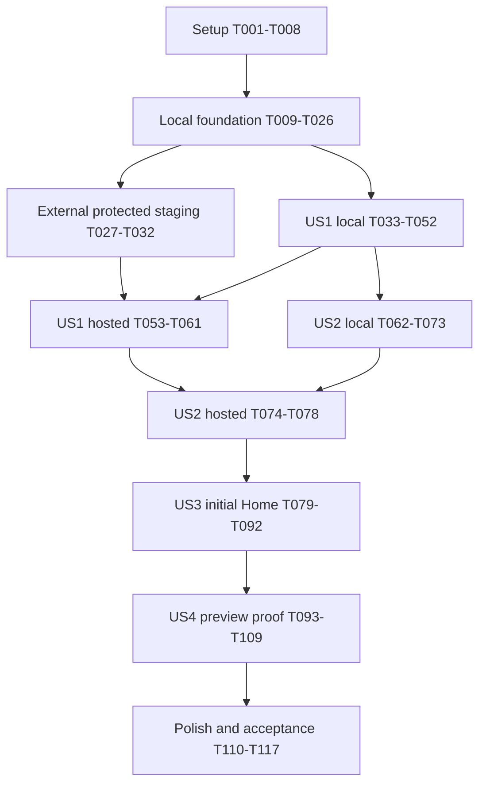

# Tasks: KEN Elevators — Phase 1 Foundation and Critical Lead Prototype

**Feature branch**: `001-phase1-lead-foundation` — retain it throughout this work.
**Generated**: 2026-10-11. **Remediated**: 2026-10-11. **Status**: Task breakdown only; no implementation, deployment, test pass or approval is claimed.
**Input**: [spec.md](spec.md), [plan.md](plan.md), [design-direction.md](design-direction.md), [research.md](research.md), [data-model.md](data-model.md), [contracts/inquiries.openapi.json](contracts/inquiries.openapi.json), [contracts/ui-localization.md](contracts/ui-localization.md), [quality-strategy.md](quality-strategy.md), [operations.md](operations.md), [dependencies.md](dependencies.md), [quickstart.md](quickstart.md), `../docs/PRD.md` and `.specify/memory/constitution.md`.

## Format and execution rules

Every implementation item uses `- [ ] Tnnn [P?] [USn?] Description`. Story labels appear only in story phases. Paths are relative to the application/Spec Kit working directory NewKenWebsite/my-project/, unless explicitly stated otherwise. The Git repository root is NewKenWebsite/. Workflows MUST be ../.github/workflows/quality.yml and ../.github/workflows/staging.yml from my-project (Git-root paths .github/workflows/...). All source/config/tests/scripts/migrations/evidence remain inside my-project. Run npm, Wrangler and .specify scripts from my-project; run Git commands with `git -C ..` from my-project, preserving the branch. Spec Kit helpers call their nested .specify root REPO_ROOT and can miss the parent .git marker; follow quickstart.md branch/path verification and feature override before any requested Spec Kit workflow, never initialize another repo. Actions checkout at Git root, use defaults.run.working-directory: my-project, and set non-run action lock/cache/artifact paths under my-project explicitly. Wrangler deploy also runs from my-project to discover functions/ and wrangler.jsonc beside build/client. New module filenames below concretize the directories in plan.md; they do not change its architecture. `E` below means `specs/001-phase1-lead-foundation/evidence/`; where used in prose it is a path abbreviation, while task lines give full paths.

Each task specifies **Deps**, requirement references and **Verify** acceptance criteria. Phase prerequisites also apply. A task is complete only when its output exists and its verification passes with evidence; writing a failing test first completes a test-definition task, but the story checkpoint requires those tests to pass. Evidence records SHA, schema/build version, actual URL where relevant, timestamp, tool/browser/profile, locale/mode, synthetic/simulated designation, outcome and unresolved DEP IDs. Store only safe private evidence; sensitive operational output goes to an approved private destination outside Git and build output. Do not put credentials, raw lead values, provider bodies or participant identities in reports.

`[P]` means a task may run with the other tasks in its documented wave **after all listed dependencies are complete**, using disjoint output files. It does not bypass phase, credential or approval gates. Tests may be authored in parallel before their implementation modules exist. Shared package/configuration/dictionary edits must be serialized; test harness/dependencies are established in Setup. No agents or external communications are authorized by this document.

**Scope**: Protected synthetic-only preview, 12 primary localized destinations (eight explicit preparation documents), two privacy documents, initial Home, both Contact modes, secure storage and recoverable simulated notifications. Preserve the PRD, constitution, remediated specification baseline and existing feature branch. Full marketing pages, genuine gallery, filters/lightbox, FAQs, enhanced cinema, analytics collectors, live email integration, production deployment and real customer intake are later work. Reserve the deferred event schema only. Never fabricate facts, contacts, assets, staff names, approvals or credentials. The proposed Phase 1 date 2026-10-23 moves when required gates cannot close.

## Design documentation update — 2026-10-13

[design-direction.md](design-direction.md) is a proposed implementation brief, not signed-off brand/content or executed UI. The plan/research palette and font candidates are updated, with existing DEP-02/03/09/12 gates retained. Home remains five concise editorial sections with all six service choices and an honest project-status inset; full marketing routes/content remain deferred. T015/T079/T081/T082/T084/T085/T087/T090 descriptions consume the brief without changed IDs, dependency edges or checkboxes. Existing T020/T080/T083/T088/T089/T091/T092/T100–T105/T108/T112/T116/T117 verification/gates apply as mapped in the design document and quality strategy.

The cinematic door/camera/pointer storyboard is later P1-F003 / delivery Phase 3 planning only. T087 is still limited to short color/opacity feedback and T002 receives no 3D package. No new task, task completion, scope exception, stakeholder approval or performance-budget increase is introduced. All prior remediation criteria and secure-persistence/recovery-first sequencing remain authoritative. Include this artifact in the next non-destructive speckit-analyze run; this update does not run implementation or analysis.

## Phase 1: Setup — shared project and verification infrastructure

**Goal**: Establish reproducible tooling without changing the selected architecture. No story label is used in this phase.
**Entry**: A later explicit implementation instruction; this task-generation request authorizes documentation only.

- [ ] T001 Capture branch, clean/dirty baseline and protected-source SHA-256 hashes in `specs/001-phase1-lead-foundation/evidence/source-baseline.md`; review all input artifacts and record differences before modifying files. Deps: none. Refs: FR-025, constitution I/VIII. Verify: branch is `001-phase1-lead-foundation`, PRD/constitution/spec hashes are recorded, and existing user changes are identified without resetting or switching branches.
- [ ] T002 Resolve and pin the plan's supported versions in `package.json`, `package-lock.json`, `.node-version` and `specs/001-phase1-lead-foundation/evidence/toolchain.md`: Node 24 LTS, React 19.3.0, Router/dev 8.4.0, Vite 8.3.x, TypeScript 6.0.x, Tailwind/plugin 4.3.x, Zod 4.x, libphonenumber-js/max 1.x, Wrangler 4.x, Sharp and the selected test tools. Deps: T001. Refs: QC-006, research R1/R9. Verify: actual patches/peer engines/advisories are checked against official sources, installation and clean `npm ci` resolve the same lock; unavailable/incompatible baselines are reported for a documented decision rather than silently substituted.
- [ ] T003 Create and own the minimal buildable Router framework/Vite/Tailwind scaffold in `vite.config.ts`, `react-router.config.ts`, `tsconfig.json`, `package.json`, `src/root.tsx`, `src/routes.ts`, `src/entry.client.tsx` and `src/routes/scaffold.tsx`, with strict types, ES2022/bundler resolution, `ssr:false`, initial route discovery and explicit SSG rather than runtime SSR. Deps: T002. Refs: FR-001/022, QC-006. Verify: minimal local build/type generation works, output is `build/client`, and no Express server, generic SPA rewrite, ORM or global state dependency is introduced. From a fresh checkout, minimal type generation/SSG build uses only this root/entry/index route with no future content/story/widget imports; T018 later enhances the same files and removes scaffold.tsx. Record this minimal-build checkpoint before Setup continues.
- [ ] T004 [P] Configure formatting, React/TypeScript linting and browser/server import boundaries in `eslint.config.js`, `.prettierrc.json` and `.prettierignore`. Deps: T003. Refs: FR-019/023, QC-006. Verify: deliberate frontend imports from `server/` or `scripts/ops/` fail lint and format/lint checks accept the scaffold.
- [ ] T005 [P] Configure separate Node/jsdom and Cloudflare runtime test projects in `vitest.config.ts`, `vitest.cloudflare.config.ts`, `tests/setup/component.ts`, `tests/setup/cloudflare.ts` and `playwright.config.ts`. Deps: T003. Refs: QC-006. Verify: independent fixtures isolate D1 state, migration loading is supported, browser checks target `wrangler pages dev`, and a failing assertion exits nonzero; browser emulation is identified separately from real devices.
- [ ] T006 [P] Define secret-safe configuration and target validation in `wrangler.jsonc`, `server/env.ts`, `config/environment.ts`, `.env.example`, `.dev.vars.example` and `.gitignore`. Deps: T003. Refs: FR-019/021, QC-004, quickstart configuration contract. Verify: names-only examples cover every documented variable, local/preview/production blocks are explicit, production is disabled, real intake is false, simulation is restricted to preview, and private env/state/export/evidence files are ignored; no actual account IDs/keys are invented.
- [ ] T007 [P] Define the safe evidence record schema and report index in `specs/001-phase1-lead-foundation/evidence/README.md` and `config/evidence-schema.json`. Deps: T003. Refs: FR-023/025, SC-009. Verify: schema distinguishes passed/failed/blocked, local/hosted and simulation/live; private reports are not deployment assets and permit no raw personal fields or secrets.
- [ ] T008 Wire the complete quickstart script interfaces in `package.json` and validate setup in `specs/001-phase1-lead-foundation/evidence/setup.md`: dev, format:check, lint, typecheck, check:contracts/content/routes, test:unit/integration, build, check:build, test:browser and check:performance. Deps: T004–T007. Refs: FR-023, QC-006. Verify: setup checks pass; future commands point to explicit implementations and cannot return a fake success when their implementation is missing; component tests are included in test:unit or an additional CI-invoked command. Run only implemented Setup checks/minimal T003 build here; content/routes/build-audit/browser/performance implementations remain pending until their named foundation owners. Invoking an absent implementation must fail with a clear missing-check message.

**Checkpoint**: Toolchain reproducible; mandatory checks have enforceable interfaces. Remaining commands become executable in their owning tasks.

## Phase 2: Foundational — localized shell, data foundation and protected staging

**Goal**: Build common prerequisites before story implementation, including basic navigation before API integration. The local foundation is T009–T026. External T027–T032 establish the hosted foundation and block hosted story verification, not isolated local code/tests. If external gates remain missing, record blocked evidence and continue only independent local tasks.

### Locally executable foundation

- [ ] T009 [P] Define typed RoutePair/Page, Dictionary, MediaAsset, SiteConfig, PrivacyNotice and approval-aware public projection models in `src/content/models.ts`. Deps: Phase 1. Refs: FR-002/003/019/025. Verify: fixtures distinguish preparation/approved and editorial/project media, omit internal permission references from public types, and cannot mistake an absent fact for a verified value.
- [ ] T010 [P] Define locale, service, inquiry/property/timeline enums and safe response/error types in `shared/inquiry-types.ts` and `shared/error-codes.ts`. Deps: Phase 1. Refs: FR-008–010/015. Verify: exactly the six contracted service IDs and all OpenAPI safe codes/categories are represented, with no coerced or additional business options.
- [ ] T011 Create paired source dictionaries and initial page/service/media/config/privacy records in `src/content/ar.ts`, `src/content/en.ts`, `src/content/pages.ts`, `src/content/services.ts`, `src/content/media.ts`, `src/content/site-config.ts` and `src/content/privacy.ts`. Deps: T009, T010. Refs: FR-003/005/018/020, QC-001. Verify: all planned visible states and metadata have nonempty paired copy; provisional test notice/copy is labeled, contacts and unverified facts are absent, and no invented image/project is included. DEP-03/08/09 remain pending where applicable.
- [ ] T012 Implement the seven paired page IDs and safe locale/query helpers in `src/lib/routes.ts`, `src/lib/locale.ts` and `src/lib/quotation-context.ts`. Deps: T009, T010. Refs: FR-001/002/010. Verify: 14 localized destinations exist; switch preserves only valid type/service, service preselects only for quotation, and malformed/duplicate/overlong/unknown query keys are dropped without copying personal data.
- [ ] T013 [P] Define UI-contract and route/query parity tests in `tests/unit/localization.test.ts` and `tests/contract/ui-localization.test.ts` against `specs/001-phase1-lead-foundation/contracts/ui-localization.md`. Deps: T011, T012. Refs: FR-001–004/010/022. Verify: tests detect missing/empty translations, unpaired routes, every service ID, unsafe context and unsupported locale fallback; expected behavior is fixed before shell integration.
- [ ] T014 Implement content/contract validation in `scripts/validate-content.ts`, `scripts/validate-contracts.ts` and `scripts/check-routes.ts`. Deps: T011–T013. Refs: FR-003/023, QC-001/006. Verify: check:content/routes/contracts fail for broken IDs/media/rights references, missing metadata/keys, invalid JSON/internal OpenAPI refs and unapproved production projections; initial content never depends on public GET fetches.
- [ ] T015 [P] Implement provisional tokens, Tailwind entry, logical layout, focus, typography and reduced-motion defaults in `src/styles/tokens.css` and `src/styles/app.css`. Deps: T011. Refs: FR-006/007, QC-002. Verify: plan token values/spacing are used, Arabic has no letter spacing, content begins visible, focus is visible and practical controls reach 44px; selections remain provisional until DEP-02 closes. Use design-direction.md §§3/5/6 for the updated provisional palette, typography roles, logical spacing and component states; rights/byte/shaping approval is not implied by the token implementation.
- [ ] T016 Implement semantic reusable primitives in `src/components/ui/Button.tsx`, `src/components/ui/Section.tsx`, `src/components/ui/FormField.tsx`, `src/components/ui/EmptyState.tsx` and `src/components/ui/ErrorState.tsx`. Deps: T015. Refs: FR-006/007/011. Verify: labels/help/errors are associated, states expose disabled/pending/error/success consistently, button/link semantics and bidi isolation are correct; document modal rules without building an unused modal.
- [ ] T017 Implement basic shared navigation in `src/components/layout/SiteShell.tsx`, `src/components/layout/Navbar.tsx`, `src/components/layout/Footer.tsx`, `src/components/layout/LanguageSwitcher.tsx` and `src/components/layout/MobileMenu.tsx`. Deps: T012, T016. Refs: FR-002/004/007/020. Verify: one six-item map plus privacy utility, visible skip link, nonmodal disclosure aria-expanded/controls, hidden links not tabbable, Escape restores trigger focus, and suppressed direct contact leaves an on-site CTA.
- [ ] T018 Enhance the T003 root/entry/routing scaffold with locale root/hydration and thin route modules in `src/root.tsx`, `src/routes.ts`, `src/entry.client.tsx`, `src/routes/home.tsx`, `src/routes/contact.tsx`, `src/routes/privacy.tsx`, `src/routes/preparation.tsx`, `src/routes/not-found.tsx`, with initial templates in `src/pages/Home.tsx`, `src/pages/Contact.tsx`, `src/pages/Privacy.tsx`, `src/pages/Preparation.tsx` and `src/pages/NotFound.tsx`. Deps: T003, T011, T017. Refs: FR-001–003/007/018/022. Verify: html lang/dir is correct before hydration, preparation/privacy/Home/Contact shell content is meaningful, deferred pages have a contact path, runtime missing copy offers localized safe home, unknown locale defaults to Arabic 404 with English option, and unavailable submit has a noscript explanation. Replace/remove `src/routes/scaffold.tsx` and its route registration, reuse the authoritative T003 files, and preserve minimal build/type generation without a duplicate root/entry/router. T019 owns the final output checkpoint.
- [ ] T019 Implement metadata and static postprocessing in `src/lib/seo.ts`, `config/render.ts` and `scripts/finalize-static.ts`; update explicit prerender list in `react-router.config.ts`. Deps: T018. Refs: FR-001/022, QC-003/004. Verify: build emits 14 documents, home indexes and leaf `locale/slug.html`, preserves generated .data/hydration assets, generates `build/client/404.html`, `build/client/ar/404.html` and `build/client/en/404.html`, plus `build/client/_headers`, `build/client/_redirects`, `build/client/robots.txt` and `build/client/sitemap.xml`, `/` preview 302, no SPA catchall, actual BUILD_ORIGIN self-canonicals/reciprocal hreflang without query, safe social metadata, empty draft sitemap, robots disallow/noindex, and final-script-hash CSP/security headers without unsafe-inline.
- [ ] T020 [P] Implement initial HTML/header/public projection/secret/budget audits in `scripts/audit-build.ts` and `config/performance-budgets.json`, plus executable baseline performance checks in `scripts/check-performance.ts`, `config/lighthouse.cjs` and `config/performance-profile.json`. Deps: T019. Refs: FR-019/022/023, QC-003/004. Verify: route-used cold first-party gzip JS/CSS and actual font/media/total transfer obey every Home/Contact/privacy-preparation budget in quality-strategy.md; broken canonicals, keys, internal evidence, secret canaries or missing CSP hashes fail the build; report Turnstile separately without excluding it from hosted speed measurements; the performance command runs existing templates on explicitly provisional planning settings, with final profile approval/measurements reserved for T101–T103.
- [ ] T021 [P] Implement static/runtime delivery tests in `tests/browser/static-routes.spec.ts` and `tests/component/navigation.test.tsx`. Deps: T019. Refs: FR-001/002/004/022, SC-001. Verify: initial HTML, refresh, paired switching, menu focus, data navigation, no-script reading, localized unknown/unsupported true 404 and foundation hydration-script CSP hashes/required-origin policy via inert script fixtures/stub challenge host (no real widget or Siteverify claim), plus baseline axe WCAG smoke are exercised under local Pages, not Vite alone. Foundation fixtures import no future T046 widget; actual lifecycle tests belong to T037/T046 and actual hosted CSP/widget/Siteverify proof to T053/T055.
- [ ] T022 [P] Implement safe server configuration checks, correlation/error responses, no-store/security headers and allowlisted logs in `server/security/configuration.ts`, `server/security/responses.ts` and `server/security/logging.ts`. Deps: T006, T010. Refs: FR-015/019/021/024. Verify: missing controls produce safe unavailable responses, Function headers are set independently of static _headers, supplied request IDs are not trusted, and logger rejects Request/Error/raw value serialization including IP/digests/hashes/tokens/full URLs. Safe status/timestamp/route projections support the request-status source contract in operations.md; application logs alone are not a complete denominator. Required provider automatic-log projection/completeness/retention is verified at T028/T075, with no presumed capabilities.
- [ ] T023 [P] Create forward SQL migrations in `migrations/0001_inquiries.sql`, `migrations/0002_notification_attempts.sql` and `migrations/0003_rate_limit_buckets.sql` exactly per data-model.md. Deps: T010. Refs: FR-013/014/016/018, QC-005. Verify: unique key hash and attempt sequence, FKs/cascade, mode/enums/range/general-mode CHECKs and required indexes are present; no raw token/key/IP, user table, mutable duplicate notification summary or replication is added.
- [ ] T024 Implement fresh/upgrade/constraint migration tests in `tests/integration/migrations.test.ts`. Deps: T023. Refs: FR-013/016, QC-005/006. Verify: isolated D1 loads migrations in order from fresh and prior schema, enforces uniqueness/FKs/checks/indexes and rejects invalid rows; local commands explicitly select --local and the same persistence path.
- [ ] T025 Create the read-only SHA-pinned quality pipeline in `../.github/workflows/quality.yml` (Git root `NewKenWebsite/.github/workflows/quality.yml`). Deps: T008, T014, T020–T024. Refs: FR-023, QC-006. Verify: npm ci, format/lint/types, contracts/content/routes, unit/component/runtime tests, SSG/build audit and local browser/axe/performance checks are mandatory, reports are private and SHA-linked, forks receive no secrets/remote D1, and missing commands/failing stages block ready status. Do not use privileged pull_request_target execution of untrusted code. Checkout at Git root; all run steps use my-project working-directory, setup-node cache-dependency-path is my-project/package-lock.json, and artifact paths include my-project/. At this checkpoint run implemented Setup/foundation suites only; inventory later mandatory suites as pending, with explicit missing-command failure and no fixture-as-hosted pass.
- [ ] T026 Run the local foundation checkpoint and record results in `specs/001-phase1-lead-foundation/evidence/foundation-local.md`. Deps: T013–T025. Refs: FR-001–004/006/019/022/023. Verify: scaffold/static/migration/content/security checks pass, basic shell works at all five widths in both directions, and unfinished story checks are explicitly pending rather than waived or passed.

### External access/approval tasks — never fabricate completion

- [ ] T027 Record Legal/KEN's synthetic-preview processor/network metadata assessment and agreed fixture/evidence cleanup policy in `specs/001-phase1-lead-foundation/evidence/synthetic-policy.md` and update `specs/001-phase1-lead-foundation/dependencies.md`. Deps: T001, T007. Refs: FR-018/019/025, QC-004; DEP-10/11. Verify: reviewer, permitted staging setup, network/log/access processing concerns, policy and decision references are recorded; no Saudi residency guarantee or production lawful-basis/retention approval is inferred.
- [ ] T028 Provision the approved staging Direct Upload Pages project, isolated D1 and real staging Turnstile widget; record non-secret targets, reviewed location/jurisdiction, tier/quota/Time Travel capabilities in `specs/001-phase1-lead-foundation/evidence/staging-resources.md` and real bindings in `wrangler.jsonc`. Deps: T006, T027. Refs: FR-021/025; DEP-04/10/11. Verify: actual account/project/DB/hostname identities and supported roles are verified, replication stays off, no production resources/data are targeted, and a location hint is never presented as regional legal clearance. Verify actual restricted request-status feed/export permissions, sampling/completeness, alias coverage, pagination, latency and provider retention needed by operations.md; do not assume the tier supplies them. Missing capability is an explicit DEP-04/12 monitoring blocker.
- [ ] T029 Obtain canonical repository, GitHub Actions/environment and deploy-permission review; record it in `specs/001-phase1-lead-foundation/evidence/ci-access.md`. Deps: T025. Refs: FR-021/023/025; DEP-05. Verify: trusted revision policy, read-only fork jobs, staging-only least-permission secrets, required review and serialized migration/deploy ownership are approved; no production deploy is enabled.
- [ ] T030 Configure server secrets, exact origin/widget hostname allowlists and Access protection for every base/hash/branch/custom alias; record redacted evidence in `specs/001-phase1-lead-foundation/evidence/preview-protection.md` and public-safe configuration in `wrangler.jsonc`. Deps: T028, T029. Refs: FR-019/021; DEP-04/05/10. Verify: unauthorized testers are denied on every reachable alias; all staging project's used env blocks bind staging only, site key alone is public, actual secrets remain provider-managed, noindex is supplementary, and real intake remains false.
- [ ] T031 Review compatibility/bookmark/export feasibility, apply approved forward migrations to the explicit remote staging target in a serialized authorized operation, and deploy the initial shell from application working directory `my-project`; record SHA/URL/schema/check results in `specs/001-phase1-lead-foundation/evidence/initial-preview.md`. Deps: T026–T030. Refs: FR-021/024; DEP-04/05/10/11. Verify: reviewed DB name/ID is asserted before --remote, Functions compile with build/client, BUILD_ORIGIN matches actual preview, no ordinary PR auto-migrates shared D1, and a compatible previous-build strategy is documented without reverse/drop SQL.
- [ ] T032 Verify the hosted foundation in `specs/001-phase1-lead-foundation/evidence/foundation-hosted.md`. Deps: T031. Refs: FR-001/021/022, SC-001/009/010. Verify: HTTPS/protection/noindex/bindings, 14 direct/refresh routes and localized true 404s pass on actual Pages; pending inquiry/recovery checks are recorded as pending, not acceptance proof.

**Checkpoint**: T026 releases local story work; T032 releases hosted API integration. Hosted gates cannot pass using mocks. Native copy/design and named recovery owners remain acceptance dependencies.

## Phase 3: User Story 1 — Send a traceable inquiry or quotation (P1)

**Goal**: Account-free bilingual general/quotation submission with reference only after durable D1 acceptance.
**Prerequisites**: T026 for local tasks; T032 plus relevant DEP IDs for hosted tasks.
**Independent test**: Directly open /ar/contact and /en/contact, exercise both modes with synthetic inputs, actual staging verification and fresh authorized DB retrieval; no completed marketing pages or email provider required. Rejection writes zero leads, accepted replay returns original reference, conflict never overwrites, and failure retains the draft.

### Tests — define expected behavior before implementation

- [ ] T033 [P] [US1] Define normalization/schema boundary tests in `tests/unit/inquiry-schema.test.ts` and `tests/unit/phone.test.ts`. Deps: T026. Refs: FR-008–010/012/018, SC-005. Verify: complete quality-strategy field matrix covers Unicode NFC/code points/control/bidi rejection, SA/international/Arabic/Persian phones, name 1/2/100/101, message 9/10/2000/2001, optional email/city limits/blanks, floor 0/1/200/201/type, enums, notice/key/token bounds, literal privacy true and quotation-only fields; no coercion or required city. UUID v4 uppercase/lowercase normalize to one lowercase identity; whitespace/braces/URN, wrong version/variant/type are rejected before trimming. Notice syntax/acknowledgement are independent of the new-acceptance current-version predicate.
- [ ] T034 [P] [US1] Define streamed body, origin, limiter and Siteverify tests in `tests/integration/security-controls.test.ts`. Deps: T026. Refs: FR-012/014, SC-005. Verify: 32767/32768/32769 UTF-8 bytes including Arabic/forged or missing Content-Length, pre-parse malformed JSON/oversized flood boundary (after transport guards; these attempts consume quota once before read/parse), exact 9/10/11 and 49/50/51 quotas, concurrent counters/network isolation, missing trusted identity, unavailable controls, invalid/expired/single-use/action/hostname tokens and transient/timeout verification cases all have explicit expectations and no lead insertion. Repeated eligible malformed/oversized requests reach 429 at the same quota cap without body read; limiter outage returns 503 before parse. Fresh quota preserves 400 INVALID_JSON/413 size errors; independent validation/verification still apply and counts remain zero.
- [ ] T035 [P] [US1] Define API/OpenAPI transport tests in `tests/contract/inquiries.test.ts` and `tests/contract/health.test.ts`. Deps: T026. Refs: FR-012/015/019/021, SC-010. Verify: expected 201/200/400/403/409/413/415/429/500/503 bodies, allowed field-error categories/max three, matching correlation header, no-store and Retry-After are checked against the contract; 405 Allow, inquiry GET/HEAD/OPTIONS/child-path confidentiality and health 200/status=ok and 503/status=unavailable are covered, including schema rejection of crossed combinations.
- [ ] T036 [P] [US1] Define atomic acceptance/hash/race tests in `tests/integration/inquiry-persistence.test.ts` and `tests/unit/payload-identity.test.ts`. Deps: T026. Refs: FR-013/014/016/018, SC-004/006. Verify: both modes/locales, normalized equivalent payloads, refreshed token, notice/locale changes, versioned hash rotation, concurrent equal/changed contenders, initial-attempt insertion failure rollback and lost/unknown commit response assert exactly one inquiry/one initial attempt or zero inserts as applicable. Explicit A → B suite: accept A/lose response, switch server/public notice to B, replay unchanged A concurrently with fresh tokens and UUID case variants; assert 200/original reference/createdAt, unchanged consent/version and exactly one inquiry/initial attempt. Valid changed payload (including B) with retained key yields 409; absent key+A yields 400/notice_changed; absent key+B yields 201. Cover lookup miss/concurrent winner and stored hash-version rotation; invalid schema/rate/token/outage still rejects safely.
- [ ] T037 [P] [US1] Define bilingual form lifecycle tests in `tests/component/contact-form.test.tsx` and `tests/component/turnstile-widget.test.tsx`. Deps: T026. Refs: FR-008/010/011/018, SC-005. Verify: unchecked privacy, editable/clearable service, mode-switch clearing, empty/partial-form pointer/keyboard Check form and single-line Enter validation via shared handler/novalidate while native Send is disabled, first-invalid/confirmation focus, repeated activation, unknown outcome, 403 refresh, 409 explicit new action, 429 cooldown, 503 retry, notice renewal and unsaved-navigation warning have acceptance assertions. Test both locales/modes, textarea newline, unchecked privacy, missing/expired token challenge/help focus after field checks, no fetch for invalid input, and disabled Send validity/token/in-flight/cooldown/configuration reasons with Check form available while editable. Distinguish new-draft notice renewal from immutable unknown-outcome A retry after B rollover. Actual widget load/expiry/reset/unmount tests remain pending until T046; foundation fixtures are not their pass evidence.

### Local implementation and integration

- [ ] T038 [P] [US1] Implement pure normalization, valid E.164 phone parsing and allowlisted Zod schema in `shared/normalize.ts`, `shared/phone.ts` and `shared/inquiry-schema.ts` exactly per data-model/OpenAPI. Deps: T033. Refs: FR-009/012/018. Verify: T033 passes including optional null/blank semantics, control/bidi rejection and independent notice syntax/true-acknowledgement validation, canonical UUID normalization and a separate current-notice predicate applied only to new acceptance by T043/T044; browser-safe code imports no secrets/server helpers.
- [ ] T039 [P] [US1] Implement fixed-order canonical payload and environment-scoped key/hash logic in `server/inquiries/idempotency.ts`. Deps: T036, T038. Refs: FR-014/019. Verify: SHA-256 key digest and versioned HMAC payload cover all contracted normalized fields with explicit nulls, exclude token/server metadata, preserve old keys for retained rows and never log digests; T036 hash tests pass. Hash exact UTF-8(environment identity + LF + lowercase hyphenated UUID v4); case variants share one key digest, invalid UUIDs fail before hashing, and material notice changes remain in the payload hash.
- [ ] T040 [P] [US1] Implement bounded UTF-8 JSON reading, method/media/origin guards and trusted network identity adapter in `server/security/body.ts`, `server/security/origin.ts` and `server/security/network-identity.ts`. Deps: T034, T038. Refs: FR-012/015/019. Verify: expose guard/identity and body-read phases separately so T044 invokes T041 quota BEFORE any read/parse; stream reading caps at 32768 regardless of declared size; same-origin/allowlisted transport and Cloudflare-trusted identity are enforced, caller forwarding headers ignored, missing hosted identity fails safely and local adapter is explicit.
- [ ] T041 [P] [US1] Implement two-window atomic D1 rate claiming in `server/security/rate-limit.ts`. Deps: T034, T040. Refs: FR-012/014, QC-004. Verify: capped UPSERT RETURNING batch consumes every transport-eligible inquiry POST once before body read/parse, including malformed/oversized and later schema/verification rejections/replay; 10/10-minute and 50/UTC-day limits, nonrefunded partial claims, day/environment-keyed HMAC identity, expired-row handling, Retry-After for both windows and 503 on control outage pass T034; no raw IP is stored. This pre-parse limiter is the selected supplemental malformed-flood control, owned by Functions Engineering; no unverified provider edge/WAF feature is required. Record bounded-D1-cost and distributed-network/platform-exhaustion tradeoffs; transport guards and bounded reading remain independent.
- [ ] T042 [P] [US1] Implement server Siteverify in `server/security/turnstile.ts`. Deps: T034, T040. Refs: FR-012/014/021. Verify: expected action=inquiry and exact configured hostnames, five-second attempt timeout, at most one transient network retry using the same token-scoped verification UUID, fail-closed statuses and no persisted token pass T034; accepted replay still requires fresh verification.
- [ ] T043 [US1] Implement parameterized acceptance repository in `server/inquiries/repository.ts`. Deps: T039, T023, T036. Refs: FR-013/014/016/018. Verify: implement authoritative retained-row policy lookup after independent controls; matching payload returns 200/original time across notice rollover, changed valid payload returns 409 before current-notice equality. A stale absent identity gets final winner lookup or 400/notice_changed without insert. Only current-notice misses proceed to one D1 batch that inserts candidate on key conflict do nothing, inserts pending sequence-one only for the new UUID, and selects authoritative row; 201/200/409 use stored hash version/time, SQL failure rolls back to 503, and no policy lookup/local lock/overwrite replaces unique-constraint/batch race arbitration. Do not mutate original notice/consent/creation time or dispatch another notification for replay; T036 A → B/concurrent/case-variant tests pass. Lookup failures are safe 503.
- [ ] T044 [US1] Compose handler and minimal health probe in `server/inquiries/handler.ts`, `server/health.ts`, `functions/api/v1/inquiries.ts` and `functions/api/v1/health.ts`; add thin API-boundary middleware in `functions/_middleware.ts` delegating to `server/security/api-boundary.ts`, and generate API-only `build/client/_routes.json` in `scripts/finalize-static.ts`. Deps: T038–T043, T022, T035. Refs: FR-012–016/019/021. Verify: plan acceptance sequence is enforced, unknown child resources return safe JSON 404 instead of static HTML, unsupported methods give 405/Allow, health reveals no counts/binding/region, pending work commits before response and response never depends on notification delivery. Helper files stay outside functions/. Order guards/trusted identity → pre-parse T041 rate claim → bounded body/schema → fresh Turnstile → retained identity classification → new-only current notice/atomic batch. Prove malformed floods cannot bypass quota and all rejected paths insert zero leads. Health must be 200/ok or 503/unavailable with matching correlation/no-store.
- [ ] T045 [US1] Run the backend contract/runtime checkpoint and store safe results in `specs/001-phase1-lead-foundation/evidence/us1-backend.md`. Deps: T044. Refs: FR-012–016/019, SC-004/005/010. Verify: T033–T036 pass in isolated Cloudflare D1 with exact record counts, rollback/races/rotation/negative access and statuses; control/storage outages give no claimed acceptance and no sensitive logs. Include all T036 A → B and UUID-case race criteria plus T034 pre-parse floods and T035 crossed-health-status rejection.
- [ ] T046 [P] [US1] Implement explicit widget lifecycle in `src/features/inquiries/TurnstileWidget.tsx`. Deps: T037, T045. Refs: FR-011/012. Verify: locale/action/site key, load/error/expiry/timeout/reset/unmount states and fresh-token retry pass widget tests, only the site key reaches the bundle, and script/widget failure leaves readable localized guidance. Run real component lifecycle tests defined by T037 after implementation; inert T021 fixtures do not satisfy this checkpoint.
- [ ] T047 [P] [US1] Implement fetch client and submission state machine in `src/features/inquiries/api.ts` and `src/features/inquiries/useInquiryForm.ts`. Deps: T037, T045. Refs: FR-011/014/015/019. Verify: expected responses are validated, unmapped codes use localized generic retry, unknown outcome retains identity/draft, cooldown respects Retry-After, token refresh does not rotate key, changed-content retry requires explicit fresh action, and no storage/URL persistence or false success occurs. Freeze submitted normalized content/notice/acknowledgement with key on unknown outcome; retry A unchanged after current notice B with fresh token. Never auto-rewrite notice/consent or key. A definitive unaccepted 400/notice_changed renews current notice with unchecked consent; a changed retained payload yields explicit 409/new-action guidance.
- [ ] T048 [US1] Implement both modes and optional building inputs in `src/features/inquiries/ContactForm.tsx`. Deps: T046, T047. Refs: FR-008–011/018. Verify: T037 passes for both locales/modes, client validity/touched/attempted-submit feedback remain usable, mode changes clear building values, privacy starts unchecked with matching notice link, pending restraint and success/error focus/announcements work, and confirmation displays only safe bidi-isolated reference. Send disabled until valid fields/privacy/fresh token and available dispatch; enabled Check form type=button handles invalid pointer/keyboard validation, and single-line Enter explicitly routes invalid attempts to the same shared handler without disabled-button activation. Form novalidate and guarded onSubmit give localized summary/first-invalid focus without fetch; textarea newline/challenge help and ready Check form focusing Send work. Send also disables in-flight/cooldown/unavailable-config with announced reason; Check form remains available while editable. T037 verifies all paths.
- [ ] T049 [US1] Integrate the form into `src/pages/Contact.tsx` and `src/routes/contact.tsx`, including post-hydration query preselection and notice/configuration checks. Deps: T048. Refs: FR-008/010/018/020/022. Verify: direct general/quotation routes have stable prerendered defaults/metadata, all six valid service contexts remain editable, notice changes renew acknowledgement only for new/definitely unaccepted drafts; unknown-outcome snapshots retain their submitted notice/consent for replay, unsaved navigation warns accessibly, noscript cannot imply usable submit, and no unverified contact links appear.
- [ ] T050 [P] [US1] Implement real local fetch/retry E2E cases in `tests/browser/inquiry-lifecycle.spec.ts`. Deps: T049. Refs: FR-008–015/018, SC-004/005. Verify: local Pages tests exercise four locale/mode combinations, transport loss/unknown acceptance, refreshed challenge, same-key replay/conflict, validation focus/draft retention, double submit and rate cooldown with restricted fixture count assertions; provider mocks are labeled local. Exercise A acceptance/response loss → B configuration → concurrent immutable A retry and UUID-case replay with 200/original reference/time/one inquiry/initial notification; changed retained notice/content 409, new A 400 and new B 201. Cover empty/partial forms, pointer/keyboard/Enter and missing token in both locales/modes.
- [ ] T051 [P] [US1] Implement privacy/confidentiality regression tests in `tests/integration/confidentiality.test.ts` and `tests/browser/form-privacy.spec.ts`. Deps: T049. Refs: FR-018/019, SC-010. Verify: bypassed client validation inserts zero leads, injection-like input renders only as text, no personal form state enters URLs/storage/analytics/logs/cache, and GET/HEAD/PUT/PATCH/DELETE/OPTIONS/child paths disclose no inquiry.
- [ ] T052 [US1] Execute local browser/component/API acceptance and record it in `specs/001-phase1-lead-foundation/evidence/us1-local.md`. Deps: T050, T051. Refs: FR-008–015/018/019, QC-006. Verify: all US1 tests plus full local checks pass, four combinations match one inquiry/reference/initial pending row each, and notification pending does not delay or negate success.

### Hosted integration and external verification

- [ ] T053 [US1] Review actual staging notice/hostname/origin/hash/rate/Turnstile bindings and tester authorization in `specs/001-phase1-lead-foundation/evidence/us1-config-review.md`. Deps: T032, T052. Refs: FR-018/019/021; DEP-04/10. Verify: server/public notice versions agree, only synthetic testing is enabled, real widget/secret and trusted network identity are available, and no test bypass or caller-controlled simulation switch is enabled on the public submission boundary. Review the protected hosted flood target `/api/v1/inquiries` on every reachable staging alias and pre-parse D1 policy/owner/configuration; plan an approved bounded fault window. Record final-script CSP/widget origin policy and controlled synthetic A → B rollover/retry configuration, without legal-notice approval claims.
- [ ] T054 [US1] Deploy the reviewed API/form candidate to protected staging and record identity/checks in `specs/001-phase1-lead-foundation/evidence/us1-deployment.md`. Deps: T053. Refs: FR-021/023; DEP-04/05. Verify: source SHA, migration version and actual URL are traceable, quality checks pass, deployment from my-project compiles its minimal Functions and every alias remains protected with staging-only bindings.
- [ ] T055 [US1] Verify actual hosted server Turnstile/action/hostname/fresh-token behavior in `specs/001-phase1-lead-foundation/evidence/us1-turnstile.md`. Deps: T054. Refs: FR-012/014/021, SC-005; DEP-04. Verify: real staging challenge succeeds, missing/expired/wrong verification fails without storage, and test-key automation is separately labeled rather than used as real hosted proof. Verify the actual widget loads/renders under final hosted CSP, hydration remains usable and real server verification succeeds; T021 fixtures/local test keys cannot count as this proof.
- [ ] T056 [US1] Demonstrate four locale/mode submissions and fresh authorized reference retrieval in `specs/001-phase1-lead-foundation/evidence/us1-persistence.md`. Deps: T055; authorized provider access under DEP-07. Refs: FR-008/013/018, SC-004. Verify: every response reference matches exactly one D1 record with server time, normalized phone, locale/notice acknowledgement and one pending notification; no raw fields are copied into evidence.
- [ ] T057 [US1] Demonstrate hosted accepted-response loss, identical retry and changed-payload conflict in `specs/001-phase1-lead-foundation/evidence/us1-retry.md`. Deps: T056. Refs: FR-011/014/015, SC-004/005. Verify: same identity/fresh token returns 200 original reference/time, conflicting content returns 409/no overwrite/new lead, and UI retains draft and offers explicit new action; request controls still apply to replay. During an approved synthetic notice A → B rollover, deliberately lose A acceptance response and perform concurrent unchanged A retries with fresh real verification. Assert 200 original reference/createdAt, unchanged consent/version and one inquiry/initial notification; case-only UUID variants resolve identically. Changed valid fields or notice B on retained identity give 409; genuinely new A gives 400/notice_changed and new B gives 201. Do not alter real-data/production settings.
- [ ] T058 [US1] Demonstrate controlled hosted rejection/rate/storage fault cases in `specs/001-phase1-lead-foundation/evidence/us1-rejections.md`. Deps: T057; approved staging fault window. Refs: FR-012/015/019, SC-005/010; DEP-04/12. Verify: invalid/oversized/media/origin/verification/429/control or storage failures return safe contracted responses, rejected cases insert zero leads, draft remains and deliberate faults are separated from normal error metrics; production resources are never altered. Repeated malformed/oversized eligible POSTs on protected staging and reachable aliases demonstrate pre-parse quota/429, fresh-quota 400/413, limiter-outage 503, bounded reading and zero new inquiry/notification rows; capture only safe counts/status, not request bodies/IPs.
- [ ] T059 [US1] Review form keyboard/screen-reader/notice interaction in both locales and modes in `specs/001-phase1-lead-foundation/evidence/us1-form-review.md`. Deps: T058; DEP-03/12 reviewer/device access. Refs: FR-011/018, QC-001/002. Verify: native reviewed labels/errors, first-invalid/summary/success focus, privacy review without losing draft, numeric bidi and all retry states pass; inaccessible required equipment/review is blocked. Empty/partial forms use enabled Check form pointer/keyboard activation and intercepted Enter in single-line fields for both modes/locales while Send is disabled; errors announce and first invalid field focuses without disabled-button activation. Verify textarea newline, missing-token challenge/help, pending/cooldown reasons and unknown A snapshot versus new B consent renewal.
- [ ] T060 [US1] Match hosted API bodies/status/headers and no-public-record behavior to OpenAPI in `specs/001-phase1-lead-foundation/evidence/us1-hosted-contract.md`. Deps: T058. Refs: FR-015/019/021, SC-010. Verify: no-store/correlation/Retry-After, 405/Allow, generic unknown-resource 404, minimal health and absence of leaked fields/secrets pass actual network inspection; no response contains provider internals. Assert HTTP 200/status=ok and HTTP 503/status=unavailable for health (crossed combinations fail), both minimal/correlated/no-store.
- [ ] T061 [US1] Record the US1 acceptance checkpoint in `specs/001-phase1-lead-foundation/evidence/us1-acceptance.md`. Deps: T056–T060. Refs: SC-004/005/010. Verify: all seven story scenarios have test/evidence links and four locale/mode combinations pass; missing external evidence leaves US1 blocked, while notification recovery is explicitly assigned to US2.

## Phase 4: User Story 2 — Recover a lead when notification fails (P1)

**Goal**: Durable simulated notification outcomes plus authorized retrieval/reconciliation/replay without a dashboard, public recovery API, queue or assumed cron.
**Prerequisites**: T052 for local recovery implementation, using persisted US1 fixtures; T061 for hosted recovery acceptance.
**Independent test**: Starting from a stored synthetic inquiry, force labeled failure/timeout/process interruption, use restricted primary/backup sessions to retrieve and replay it, and demonstrate one-business-day visibility with no new inquiry.

### Tests

- [ ] T062 [P] [US2] Define lease/state/retry/interruption tests in `tests/integration/notification-recovery.test.ts`. Deps: T052. Refs: FR-016/017/024, SC-006. Verify: success/failure/timeout, death after commit/before claim/after claim/before outcome, 120-second lease expiry/stale-result fencing, orphan pending repair, concurrent claims/sequences, 1-minute/5-minute eligibility, third failure escalation and deliberate subsequent recovery have assertions retaining one inquiry.
- [ ] T063 [P] [US2] Define restricted-target/retrieval/cleanup/alert tests in `tests/integration/operator-tools.test.ts` and `tests/unit/alert-rules.test.ts`. Deps: T052. Refs: FR-017/019/024, SC-010. Verify: unauthenticated/wrong account/DB/production targets are refused; defaults emit safe counts/references only, private retrieval requires explicit destination; threshold boundaries include >1%/15m with no invented minimum denominator, >=15m pending/failure age or three failures/15m, 60m escalation and missed daily review. Use operations.md source/freshness contract: complete unsampled API totals including rejection/platform 5xx, >1% at N=1 and exact 1%, zero traffic versus missing data, minute-window edges/pagination/≤60s lag, unresolved notification age across retries, 60s evaluations, 2m missed heartbeat, missed daily-review grace, dedup/reset/reopen/60m repeats and failed-input no-healthy behavior. Provider fixtures are local and never hosted feed proof.

### Local implementation

- [ ] T064 [US2] Implement notification repository/state/compare-and-swap lease fencing in `server/notifications/repository.ts` and `server/notifications/state-machine.ts`. Deps: T062. Refs: FR-016/017. Verify: persisted pending/running/terminal history and mode-specific statuses, guarded next unique attempt and late-owner rejection pass T062; summary derives from latest attempt and does not overwrite past evidence.
- [ ] T065 [P] [US2] Implement environment-controlled success/failure/timeout simulation in `server/notifications/simulation.ts` and adapter types in `server/notifications/types.ts`. Deps: T062. Refs: FR-016/021. Verify: recorded mode=simulation and simulated_success are explicit, no email is sent, no body/query/header controls outcome and production rejects launch-ready simulation configuration.
- [ ] T066 [US2] Implement post-commit best-effort dispatcher in `server/notifications/dispatcher.ts` and integrate waitUntil in `server/inquiries/handler.ts`. Deps: T064, T065. Refs: FR-013/016. Verify: claims persist before adapter activity, success response survives adapter failure/timeout/death, replay acceptance creates no new initial attempt, and interruption remains discoverable without request-lifetime dependence.
- [ ] T067 [P] [US2] Implement restricted target guard and daily safe reconciliation in `scripts/ops/target.ts` and `scripts/ops/reconcile.ts`. Deps: T063, T066. Refs: FR-017/019/024. Verify: actual provider-authenticated explicit preview target is required; left join finds missing attempt/pending/failed/stale/escalated work, unique guarded repair never creates an inquiry, and default output contains only safe counts/status/references. Write a safe reconciliation UTC/count receipt at the shared approved private destination outside Git/build output; operators can inspect last successful review without lead details.
- [ ] T068 [P] [US2] Implement deliberate reference retrieval in `scripts/ops/retrieve.ts`. Deps: T063, T066. Refs: FR-017/019. Verify: selected UUID and approved private secure output destination are mandatory, stdout/history/CI reports never contain personal fields, organization authorization is enforced and wrong/unauthorized targets fail before access.
- [ ] T069 [US2] Implement eligible replay and explicit post-escalation recovery in `scripts/ops/replay.ts`. Deps: T067, T068. Refs: FR-017/024. Verify: reuse stored inquiry, serialize/lease-fence next attempt, enforce 1m/5m/three-attempt policy, record corrected deliberate recovery safely, and T062 proves no duplicate inquiry or claims of exactly-once inbox delivery.
- [ ] T070 [P] [US2] Implement scoped synthetic cleanup and expired counter deletion in `scripts/ops/cleanup.ts`. Deps: T067, T027. Refs: FR-019/024. Verify: policy/target/synthetic-only guard and server-set test_record control deletion, linked attempts cascade, expired counters are removed within agreed maximum 48h operational window, production is refused, and approved projected monitor samples/heartbeats expire within the proposed maximum 48h, incident receipts follow approved evidence policy, and safe receipts retain no raw data; purged fixture UUIDs are never reused.
- [ ] T071 [P] [US2] Implement restricted read-only alert summaries and deterministic incident evaluation in `scripts/ops/alerts.ts`, `scripts/ops/request-status.ts` and `server/notifications/alert-rules.ts`. Deps: T063, T067. Refs: FR-024, QC-007. Verify: all runbook thresholds/deduplication/repeat/escalation and denominator/sample size pass T063, stdout/alert payload is safe and no public counts/status endpoint or scheduler service is added. Implement operator-started attended ≤60s polling, validated source adapter/private projections, complete rolling N/E window, D1 unresolved-age/failure queries, review receipts, freshness/heartbeat failures and private atomic incident state per operations.md. Local fixture inputs must be labeled; no healthy result from sampled/missing/delayed data. Monitor input failures block intake coverage. Provider acquisition is configured only after actual capabilities are verified in T075.
- [ ] T072 [P] [US2] Expand executable runbook and private retrieval instructions in `specs/001-phase1-lead-foundation/operations.md` and CLI usage in `specs/001-phase1-lead-foundation/quickstart.md`. Deps: T069–T071. Refs: FR-017/024/025. Verify: primary/backup daily proposed 09:00 Asia/Riyadh schedule, one-business-day secure handoff, interrupted leases, replay/escalation, credential location, target assertions, cleanup and actual role limitations are documented without inventing staff or adopted production retention. Document minute monitoring start/stop/coverage, independent backup heartbeat check, precise source acquisition adapter, private retention/incident state, missing-data incident, named handoff and ≤120s threshold-reporting bound under complete ≤60s-lag inputs; daily reconciliation is not minute alert evaluation.
- [ ] T073 [US2] Run local simulated recovery/ops verification and record results in `specs/001-phase1-lead-foundation/evidence/us2-local.md`. Deps: T066–T071. Refs: FR-016/017/024, SC-006/010. Verify: T062/T063 and all prior inquiry tests pass, every injected interruption remains retrievable/recoverable, retries preserve inquiry count and unauthorized tooling cannot disclose data.

### External operational access and hosted proof

- [ ] T074 [US2] Establish named primary/backup staff, least-privilege provider roles/MFA, private destinations, daily schedule and escalation recipients in `specs/001-phase1-lead-foundation/evidence/operator-access.md` and `specs/001-phase1-lead-foundation/dependencies.md`. Deps: T072, T073, T061. Refs: FR-017/019/025; DEP-07/10/11. Verify: both real authorized sessions and an unauthorized attempt are exercised, actual provider role capability is recorded, and secure one-business-day handoff ownership is accepted; no credentials appear in documents. Assign monitored-preview primary/backup coverage, independent ≤2m backup heartbeat checks, approved safe shared state destination and Operations/Engineering escalation owners; unstaffed intake remains denied.
- [ ] T075 [US2] Configure the approved restricted monitoring/alert channel and record redacted routing evidence in `specs/001-phase1-lead-foundation/evidence/monitoring-setup.md`. Deps: T071, T074, T028, T027. Refs: FR-024, QC-007; DEP-07/12. Verify: chosen operational mechanism/permissions and recipients exist, all thresholds and missed-reconciliation escalation are configured without public lead data or a new unapproved scheduler; any required test message is sent only with separate explicit authorization. Record the exact actual Cloudflare restricted request-status interface/command/adapter and tier, complete unsampled API/alias/platform-status coverage, pagination/watermark, ≤60s lag, retention/permissions and safe projection. Record D1 query scope, ≤60s evaluations, monitor coverage, named recipients/private routing sink and DEP-10/11 retention decision. Missing capability/access/coverage is blocked under DEP-04/07/12, never an assumed feature or invented approval.
- [ ] T076 [US2] Deploy and demonstrate hosted simulated outcomes/interruption/replay in `specs/001-phase1-lead-foundation/evidence/us2-hosted-recovery.md`. Deps: T073–T075; trusted staging deploy/checks as T054. Refs: FR-016/017/021/024, SC-006. Verify: actual D1 keeps lead/reference and initial pending work through each interruption, primary/backup retrieval succeeds, retries/escalation observe timing/fencing, original visitor confirmation remains successful and every outcome is labeled simulated rather than live delivery.
- [ ] T077 [US2] Demonstrate hosted safe summary/alert routing and daily handoff in `specs/001-phase1-lead-foundation/evidence/us2-alerts.md`. Deps: T076. Refs: FR-017/024, QC-007, SC-006; DEP-07/12. Verify: controlled >1% 5xx/15m and sustained notification faults reach the approved restricted mechanism, threshold/reset/escalation and missed-review cases are demonstrated, owner visibility occurs within one business day and deliberate fault windows are excluded from normal metrics; recording a local alert alone is insufficient. Demonstrate exact hosted N/E counts and >1% with no minimum denominator, ≥15m unresolved age across retries, ≤60s evaluations/recorded source lag/report by ≤120s under source contract, safe routing, dedup/reset/reopen/60m repeats, missing feed/heartbeat, backup takeover and missed daily review. Verify deliberate fault stream triggers alerts but is separated from normal metrics without masking unrelated errors.
- [ ] T078 [US2] Record all five US2 scenarios in `specs/001-phase1-lead-foundation/evidence/us2-acceptance.md`. Deps: T076, T077. Refs: SC-006/010. Verify: durable failure/recovery/access/alert evidence passes with no new inquiry, missing dependencies remain blocked, and DEP-06 live vendor/recipient delivery stays a later gate rather than a false Phase 1 blocker or pass claim.

## Phase 5: User Story 3 — Browse a premium bilingual foundation (P2)

**Goal**: Complete initial Home and reusable premium patterns after durable lead/recovery proof; basic navigation was delivered in Foundation.
**Prerequisites**: T078 before homepage decorative enhancement. Design/content review preparation may occur earlier without modifying story implementation or shared files.
**Independent test**: Inspect Home, Contact, privacy and preparation states in both locales at 360/390/768/1024/1440px, with keyboard/screen reader, reduced motion and failed media/enhancements. Every CTA resolves, unsafe context is ignored and unverified facts/actions remain absent.

### Tests

- [ ] T079 [P] [US3] Define token/component/CTA/fallback tests in `tests/unit/design-tokens.test.ts` and `tests/component/home-foundation.test.tsx`. Deps: T078. Refs: FR-005–007/020, SC-002/008. Verify: 4.5:1 normal text/3:1 large text and applicable control contrast, approved-or-preparation sections, all six choices, honest project/media fallback and unavailable contact suppression have assertions. Also assert the five-section wireframe retains the restaurant entry, installation/maintenance choices and inline project-preparation status; gold/ivory (2.22:1) is decorative only and essential control/text states use the documented contrasting pairs.
- [ ] T080 [P] [US3] Define the five-width bilingual navigation/resilience matrix in `tests/browser/bilingual-foundation.spec.ts`. Deps: T078. Refs: FR-001–007/010, QC-001/002. Verify: route/safe-context switching, focus/hidden menu targets, no overflow/Arabic clipping, LTR numeric isolation, no-script reading, reduced motion and failed image/enhancement keep content/CTAs reachable across the matrix.

### Implementation and acceptance

- [ ] T081 [P] [US3] Implement reusable marketing patterns in `src/components/marketing/PageHero.tsx`, `ServiceCard.tsx` and `CTASection.tsx`. Deps: T079, T080. Refs: FR-005/006/007/010. Verify: semantic headings/links, safe typed service CTA context, reserved responsive picture space/alt/fallback and motion-independent primary action satisfy component tests. Follow design-direction.md §4: copy/actions stay outside the static Hero media frame, and three featured cards plus the compact restaurant entry do not replace six stable service choices.
- [ ] T082 [P] [US3] Add initial Home sections and documented component/state rules in `src/content/home.ts` and `specs/001-phase1-lead-foundation/evidence/design-system.md`. Deps: T079, T080. Refs: FR-003/005/006; DEP-02/03/09. Verify: paired hero/quotation/six choices/differentiator/project-preparation/closing contact copy has no unsupported claims; token/font/spacing/state/modal accessibility rules and pending approval references are explicit. Follow design-direction.md five-section content/wireframe and component rules; proposed benefit themes remain preparation text until verified/editorially approved, and project status is retained as an inline inset rather than a sixth editorial section.
- [ ] T083 [P] [US3] Implement rights-aware responsive media optimization in `scripts/optimize-media.ts`; emit only supplied approved derivatives/licenses under `public/media/` and `public/licenses/`. Deps: T079, T080. Refs: FR-005/007, QC-003; DEP-09. Verify: fixture pipeline produces AVIF/WebP/JPEG/srcset with dimensions/paired alt and internal rights evidence excluded; actual missing assets retain honest CSS fallback without generated or stock images presented as KEN work, and mobile imagery budgets pass.
- [ ] T084 [P] [US3] Configure approved local font delivery in `src/styles/fonts.css` and supplied licensed WOFF2/license files under `public/fonts/` and `public/licenses/fonts/`. Deps: T079, T080; DEP-02 rights/selection when assets are installed. Refs: FR-006/007, QC-001/003. Verify: Arabic shaping/diacritics survive any subset, font-display swap and selective preload avoid unnecessary downloads, selected-locale bytes <=120 KiB or approved exception, and absent approvals use documented provisional/system fallback without pretending font sign-off. Evaluate the requested Alexandria 600/optional 700 headings, IBM Plex Sans Arabic 400/500 body and Manrope English from design-direction.md §3.3; record exact file hashes/upstream revision/license and reserved-name/subset provenance, actual selected-locale bytes including Latin fragments, shaping/diacritics and slow/blocked-font fallback/CLS evidence. If rights or ≤120 KiB fit cannot be proved, keep a documented reviewed system/provisional fallback and pending selection; no automatic font-budget increase.
- [ ] T085 [US3] Compose initial Home in `src/pages/Home.tsx` and `src/routes/home.tsx`, retaining preparation templates for deferred destinations. Deps: T081–T084. Refs: FR-005/006/007/022. Verify: hero/quotation, six service choices, honest differentiator/project states and closing CTA render in initial HTML, no content fetch is required, critical hero is eager/high priority only when supplied, and below-fold media is lazy with reserved space. Compose the five editorial sections in design-direction.md §4, with three featured cards plus restaurant choice, three approved/preparation benefit rows and inline project status, installation/maintenance entries and final CTA. Shared navigation/footer/route obligations remain; no completed service descriptions or company facts are inferred.
- [ ] T086 [US3] Implement verified contact URL helpers and shared optional actions in `src/lib/contact-links.ts` and `src/components/ui/ContactActions.tsx`; integrate them in `src/components/layout/Footer.tsx` and `src/pages/Contact.tsx`. Deps: T085. Refs: FR-020, SC-008/010; DEP-08. Verify: absent/unverified channels produce no tel/wa.me anchor, fixture tests validate encoded international/localized service destinations and explicit user activation, and a findable on-site form remains; live-channel rollout is deferred if no real approval is supplied.
- [ ] T087 [US3] Add only 120–180ms decorative color/opacity transitions and resilient fallbacks in `src/styles/app.css` and `src/components/marketing/PageHero.tsx`. Deps: T086. Refs: FR-007, QC-002/003. Verify: no parallax/reveal-hidden content/autoplay/scroll hijacking, reduced-motion/static/image/error behavior passes T080 and no added motion library or later cinematic feature is introduced. The later door-opening storyboard, camera depth, pointer parallax, video and React Three Fiber path in design-direction.md §§7–8 are explicitly excluded from this task; the Phase 1 premium treatment is a still or honest CSS surface.
- [ ] T088 [US3] Run component/browser/axe/build-budget checks and record matrix results in `specs/001-phase1-lead-foundation/evidence/us3-automated.md`. Deps: T087. Refs: SC-001/002/010, QC-001–003/006. Verify: T079/T080 and previous story regression suites pass, axe has zero known critical/serious violations with AA findings resolved/reviewed, 14 documents and every cold-route budget pass, and no later-phase feature or internal rights reference leaks into output.
### External manual review and approvals

- [ ] T089 [US3] Perform manual bilingual keyboard/NVDA/VoiceOver, contrast/reflow/zoom, motion/media failure and five-width review in `specs/001-phase1-lead-foundation/evidence/us3-accessibility.md`. Deps: T088; DEP-12 actual equipment/reviewers. Refs: FR-004/007, QC-001/002. Verify: all Phase 1 templates/states have no critical keyboard/screen-reader failure, correct focus/reading/bidi, practical >=44px targets or recorded exceptions and no clipped Arabic; scores/emulation do not replace manual evidence.
- [ ] T090 [US3] Obtain wireframe/paired route-content model/provisional token/font/brand presentation review in `specs/001-phase1-lead-foundation/evidence/design-approval.md`. Deps: T089. Refs: FR-006/025; DEP-02. Verify: KEN/Designer identify reviewed revision, approved provisional scope/rights and outstanding final art direction; no invented sign-off is entered. Review the proposed palette/type hierarchy/five-section wireframes from design-direction.md, six service choices/project inset, exact-file font provenance and static Phase 1 fallback; any later cinematic decision stays separate and is not a Phase 1 acceptance condition.
- [ ] T091 [US3] Obtain independent native Arabic and English visible-copy/metadata/alt/preparation/privacy review in `specs/001-phase1-lead-foundation/evidence/editorial-approval.md`. Deps: T089. Refs: FR-003/005/018/025, QC-001; DEP-03/08/09/10. Verify: 100% visible strings have reviewer/revision evidence, unsupported claims/contact facts/assets remain omitted, fixture notice is clearly synthetic and production legal notice remains gated.
- [ ] T092 [US3] Record all six US3 scenarios in `specs/001-phase1-lead-foundation/evidence/us3-acceptance.md`. Deps: T090, T091. Refs: SC-001/002/008. Verify: five-width parity, language/menu/focus/resilience/CTA/honesty and approval evidence pass; missing review/device/rights evidence leaves the applicable gate blocked rather than inferred complete.

## Phase 6: User Story 4 — Review a verifiable preview (P2)

**Goal**: Trusted CI/deployment, hosted critical walkthrough and reproducible candidate evidence with explicit remaining gates.
**Prerequisites**: T092 and accepted US1/US2 evidence for final candidate verification. Local workflow/test definition may start after T026 only if it does not modify shared story files or imply hosted acceptance.
**Independent test**: Review SHA/URL/checks and dependencies, inspect localized initial HTML and true 404s, prove Arabic-mobile entry → English → stored synthetic inquiry → authorized retrieval/recovery, and verify zero production activity.

### Tests and deployment implementation

- [ ] T093 [P] [US4] Define protected hosted cross-story smoke and alias/isolation expectations in `tests/browser/hosted-preview.spec.ts` and `tests/contract/deployment-policy.test.ts`. Deps: T092. Refs: FR-021–025, SC-009/010. Verify: configuration fixtures reject missing origin/protection/real bindings, production deploy/intake, exposed aliases or unreviewed migrations, and hosted journeys require real verification/storage evidence rather than local mocks.
- [ ] T094 [US4] Implement trusted staging deployment and private hosted verification jobs in `../.github/workflows/staging.yml`, strengthening `../.github/workflows/quality.yml` (both at Git root) to run all completed suites. Deps: T093, T029. Refs: FR-021/023, QC-006; DEP-05. Verify: reviewed full-SHA Actions, least-permission environment secrets, explicit account/project/branch/SHA, serialized authorized migrations, success-dependent Direct Upload from `my-project` and private smoke artifacts; fork code never receives deploy/Access credentials and production jobs remain disabled. Use my-project for all run steps and explicit my-project prefixes for lock/cache/artifact/non-run action inputs. Run all implemented story suites; hosted/manual missing mandatory evidence blocks readiness and cannot pass via an early fixture.
- [ ] T095 [P] [US4] Implement environment/CSP/bundle/workflow confidentiality audit in `scripts/audit-security.ts` and `tests/contract/security-policy.test.ts`. Deps: T092. Refs: FR-019/021/023, QC-004, SC-010. Verify: harmless secret canaries detect server leakage in assets/source maps, all used preview/base env bindings are staging-only, CSP permits hydration/widget with final hashes/minimal origins, static/Function headers are independent, and no logs/URLs/analytics/public recovery endpoint disclose personal values. Workflow audit reads Git-root files via `../.github/workflows/`; cache/artifact paths and my-project working directories must match the application boundary.

### Hosted checks and external reviews

- [ ] T096 [US4] Deploy the complete candidate via the reviewed trusted workflow and record migration/check/SHA/actual URL in `specs/001-phase1-lead-foundation/evidence/candidate-deployment.md`. Deps: T094, T095; DEP-04/05/10. Refs: FR-021/023. Verify: candidate quality passes, reviewed explicit staging target/migration compatibility and bookmark are recorded, actual BUILD_ORIGIN metadata matches, all aliases remain protected, production is disabled and no secret is included in deployment output evidence.
- [ ] T097 [US4] Run hosted route/SEO/initial-response checks in `specs/001-phase1-lead-foundation/evidence/hosted-html-seo.md`. Deps: T096. Refs: FR-001/022, SC-001/009. Verify: all 14 localized documents/direct refresh/client data assets, `/` 302 Arabic entry, true ar/en/default unsupported-locale 404, distinct metadata/self-canonicals/reciprocal hreflang, safe social output, preview sitemap/robots/noindex/X-Robots-Tag and omitted unverified structured facts pass actual network inspection without extra initial content fetch.
- [ ] T098 [US4] Execute the hosted mobile Arabic-entry → English → valid submission → authorized retrieval walkthrough and all four mode/locale regression cases in `specs/001-phase1-lead-foundation/evidence/hosted-critical-journey.md`. Deps: T097; DEP-04/07/12. Refs: FR-021/023, SC-004–006/009. Verify: actual widget/server/D1, invalid rejection, replay/conflict and hosted labeled notification failure/interruption/recovery all match references/counts; a fresh operator session proves persistence and no live inbox delivery is claimed.
- [ ] T099 [US4] Verify every alias/access boundary and staging/production isolation in `specs/001-phase1-lead-foundation/evidence/hosted-isolation.md`. Deps: T098. Refs: FR-019/021, SC-010; DEP-04/05/10. Verify: unauthorized base/hash/branch/custom URLs are protected/denied, safe API negative access/log/cache/bundle inspection passes, synthetic submissions create zero production records or production notifications, and Access service secrets stay only in private runners.
- [ ] T100 [US4] Execute actual supported-browser/device compatibility matrix in `specs/001-phase1-lead-foundation/evidence/browser-device-matrix.md`. Deps: T099; DEP-12. Refs: FR-007/023, QC-006. Verify: latest two major Chrome/Firefox/Safari/Edge and current iOS Safari/Android Chrome are recorded by actual version with critical journey outcomes for both locales; Playwright WebKit/mobile emulation is separately labeled, missing access remains blocked. Any enabled verified phone/WhatsApp action includes actual mobile and desktop launch evidence tied to T086/DEP-08; fixture encoding tests alone do not satisfy it.
- [ ] T101 [US4] Obtain QA/Product Owner agreement on profile/budgets and freeze configuration in `config/lighthouse.cjs`, `config/performance-profile.json` and `specs/001-phase1-lead-foundation/evidence/performance-agreement.md`. Deps: T096; DEP-12. Refs: QC-003, SC-007. Verify: exact tools/runner, 390x844/DPR1/4x CPU/150ms RTT/1600 down/750 up/cold cache/no warm worker and simulated-versus-applied throttling are recorded; every planned budget/exception has explicit decision evidence before acceptance measurements.
- [ ] T102 [US4] Extend the baseline performance script and run five cold mobile Lighthouse runs per Home/Contact locale plus privacy accessibility in `scripts/check-performance.ts` and record results in `specs/001-phase1-lead-foundation/evidence/performance-lab.md`. Deps: T100, T101. Refs: QC-002/003, SC-007. Verify: Home/Contact median performance >=90, representative Home/Contact/privacy accessibility >=95, per-run/median lab LCP <=2.5s and CLS <=0.10 are assessed, all first-party budgets pass and hosted Turnstile transfer/cost is included in speed results; failures require remediation/retest, lab numbers are never labeled field p75.
- [ ] T103 [US4] Implement/run critical-content and interaction traces in `tests/browser/performance-interactions.spec.ts` and record evidence in `specs/001-phase1-lead-foundation/evidence/interaction-lab.md`. Deps: T102. Refs: QC-003, SC-007. Verify: navigation-start to localized H1/quotation CTA visible/usable <=2s where practicable, menu/switch/validation/confirmation lab INP <=200ms on applied profile; exceptions include owner/approval/expiry, TBT is not called INP and field data is explicitly insufficient.
- [ ] T104 [US4] Arrange approved synthetic usability scenarios and >=10 representative residential/commercial participants spanning both locales in `specs/001-phase1-lead-foundation/evidence/usability-plan.md`. Deps: T096; DEP-12 participant/reviewer access. Refs: SC-003/008. Verify: actual sample split (proposal >=5 per locale), fixed villa quotation task, completion/assistance/timing and five-point trust/contact questions are agreed without placing participant identities in repository/public reports; no external invitations are sent without explicit authorization.
- [ ] T105 [US4] Conduct usability sessions and record anonymous aggregate outcomes in `specs/001-phase1-lead-foundation/evidence/usability-results.md`. Deps: T100, T103, T104. Refs: SC-003/008. Verify: >=10 actual testers, >=85% unassisted completion, prepared villa journey <3m and mean trust/contact clarity >=4.5/5 are measured; zero fabricated claims/projects/contact links and findings/remediation are recorded, with failures preventing acceptance.
- [ ] T106 [US4] Rehearse compatible preview app rollback and recovery in `specs/001-phase1-lead-foundation/evidence/preview-rollback.md`. Deps: T099, T077; DEP-04/05/07. Refs: FR-024, QC-007. Verify: revert to known compatible app revision without reversing/dropping SQL, previously accepted synthetic references and pending recovery remain retrievable, then restore candidate and verify it; incident DB restoration is not treated as ordinary app rollback.
- [ ] T107 [US4] Record lifecycle/export/deletion/backup/restore feasibility with Legal/Operations/Engineering in `specs/001-phase1-lead-foundation/evidence/lifecycle-feasibility.md` and `specs/001-phase1-lead-foundation/dependencies.md`. Deps: T106; DEP-10/11. Refs: FR-024/025, QC-004/007. Verify: actual tier/history limits, plaintext export/encryption/location/access, history deletion implications, RPO/RTO owners and separate synthetic restore procedure feasibility are reviewed; 12-month lead/30-day daily backup proposals remain unapproved, and production policy/restore drill are explicitly later gates.
- [ ] T108 [US4] Reconcile approvals and all DEP-01–013 statuses/owners/gates/evidence against the candidate in `specs/001-phase1-lead-foundation/dependencies.md` and `specs/001-phase1-lead-foundation/evidence/approval-register.md`. Deps: T105–T107, T090, T091. Refs: FR-025, SC-009. Verify: Phase 1 provisional design/native copy/actual hosted services/operators/profile/QA gates are closed only with evidence; PRD sign-off and later email/contact/gallery/privacy/lifecycle/domain/P0/release dependencies remain accurately pending where unresolved.
- [ ] T109 [US4] Record the four US4 scenarios and candidate preview-ready decision in `specs/001-phase1-lead-foundation/evidence/us4-acceptance.md`. Deps: T097–T108. Refs: FR-021–025, SC-009/010. Verify: every mandatory automated/manual/approval gate links to this revision/URL and passes; any missing/failing gate yields blocked/not-ready with DEP/owner/consequence, never readiness from deployment alone or simulation in place of actual D1/Turnstile.

## Phase 7: Polish and cross-cutting Phase 1 readiness

**Goal**: Reproducible handoff and evidence review; this phase does not implement or authorize a public release.
**Prerequisite**: All story checkpoints T061, T078, T092 and T109 passed. If fixes change code, repeat affected tests and regenerate dependent build/hosted evidence for the new candidate; do not broaden testing without a relevant change or unresolved failure.

### Local review and final checks

- [ ] T110 [P] Validate the entire fresh-checkout quickstart against actual implemented commands/targets and update `specs/001-phase1-lead-foundation/quickstart.md` plus safe results in `specs/001-phase1-lead-foundation/evidence/quickstart-validation.md`. Deps: T109. Refs: FR-023/024. Verify: clean npm ci/local migrations/full Pages/build/test and restricted CLI instructions work with explicit target selection; proposed names are replaced only by verified configuration, no command silently selects --remote/production and no existing user workspace is deleted.
- [ ] T111 [P] Complete the Phase 1 security/privacy review in `specs/001-phase1-lead-foundation/evidence/security-review.md`. Deps: T109. Refs: FR-012/014/018/019, QC-004, SC-010. Verify: dependency advisories, parameterized SQL, headers/CSP/HTTPS, secret isolation, independent validation/rate/Turnstile/idempotency and no public lead/PII exposure pass; critical findings are fixed/retested or remain blockers, and no legal clearance is inferred from technical review. Include hosted pre-parse malformed/oversized flood evidence, A → B replay/control/confidentiality cases, canonical UUID-case hashing and health status/body consistency; unresolved security failures remain blockers.
- [ ] T112 [P] Complete scope/content and future-release obligation review in `specs/001-phase1-lead-foundation/evidence/scope-review.md`. Deps: T109. Refs: FR-005/020/025, constitution I. Verify: only foundation slices of P0-F001–007 exist, six service IDs/empty-project safeguards hold, deferred event names remain schema-only, no analytics/later feature/live email/production implementation is introduced, and later >=3 real projects/>=6 images/full pages/contact requirements remain recorded.
- [ ] T113 Run all final mandatory candidate checks and record their exact commands/results in `specs/001-phase1-lead-foundation/evidence/final-checks.md`. Deps: T110–T112. Refs: FR-023, QC-006. Verify: formatting/lint/types/contracts/content/routes/unit/component/D1 integration/SSG/header-bundle-budget audit/local browser/axe/performance and candidate hosted regression pass; any code correction causes relevant evidence regeneration and the final SHA matches reports.
### Restricted hosted cleanup and final handoff

- [ ] T114 Run authorized scoped preview fixture cleanup after evidence capture and record only a safe receipt in `specs/001-phase1-lead-foundation/evidence/cleanup-receipt.md`. Deps: T113, T070; DEP-07/11 approved fixture/evidence policy. Refs: FR-019/024. Verify: only intended synthetic inquiries/attempts and expired rate rows are removed, production is untouched, retention policy is followed, purged identities are retired and only non-sensitive private acceptance evidence remains.
- [ ] T115 Audit traceability, report privacy and protected-source integrity in `specs/001-phase1-lead-foundation/evidence/traceability.md`. Deps: T114. Refs: FR-025, QC-001–007, SC-001–010. Verify: every FR/QC/SC and story scenario has implementation/test/approval evidence or explicit later gate, no report contains raw data/secrets, branch/protected-source hashes match T001, and completed checklist items have independently verifiable outputs.
- [ ] T116 Update Phase 1 handoff, blocked/later release gates and owner actions in `specs/001-phase1-lead-foundation/evidence/handoff.md`, `specs/001-phase1-lead-foundation/operations.md` and `specs/001-phase1-lead-foundation/dependencies.md`. Deps: T115. Refs: FR-024/025. Verify: daily two-operator reconciliation/escalation and rollback instructions are usable; live email/contacts/full content/gallery/legal geography/retention/backups/restore/domain/production P0 smoke/KEN launch approval stay later obligations, future 30-day/day-90 metrics are not claimed from preview tests. Carry the staffed minute monitoring mechanism, actual source/retention/permissions, backup heartbeat/intake coverage and missing-data escalation into handoff; do not equate daily reconciliation with short-window alert detection.

### External Phase 1 acceptance

- [ ] T117 Obtain Product Owner/QA/KEN Phase 1 acceptance on the exact candidate and record the decision in `specs/001-phase1-lead-foundation/evidence/phase1-acceptance.md`. Deps: T116; DEP-01/02/03/04/05/07/12 applicable evidence. Refs: SC-001–010, FR-025. Verify: all Phase 1 checks and required approvals have named decision/evidence references, outstanding later blockers are accepted as tracked obligations, and the decision explicitly grants no production deployment, real-data intake or public-launch authorization; withheld approval remains blocked.

## Dependencies and execution order

The graph shows primary paths; every task's Deps and DEP IDs are additional prerequisites. Range notation is inclusive. A phase entry with an external gate is not evidence that gate is closed. T027 can begin after Setup while the local foundation is built. T028–T032 are externally ordered. T056 requires authorized provider access before detailed retrieval; T074 subsequently formalizes and proves both operational staff roles. US2 cannot be accepted until US1 is accepted. US3 Home decoration waits for hosted recovery proof T078, honoring constitution foundation sequencing. US4 final evidence waits for US1/2/3; an isolated workflow/test draft is not a passed story. Separate external review planning may proceed early without marking execution tasks complete.

Within stories: define tests → models/pure rules → services/storage → endpoint → client integration → local verification → actual hosted verification → acceptance. No story requires full deferred marketing pages; US1 is independently tested directly at Contact, US2 from persisted fixtures, US3 from the shared shell/initial Home, and US4 from revision-linked preview evidence. Independence describes the test surface, not removal of genuine persistence/access dependencies.

### Safe parallel waves and examples

All marked tasks have these opportunities; tasks within a wave own disjoint files. Prerequisites listed on each task must finish before that task joins the wave. Multiple waves cannot be assumed independent. Unmarked shared-file tasks are serialized.

| Phase/story | Parallel wave (task IDs) | Ready condition |
|---|---|---|
| Setup | T004, T005, T006, T007 | T003 complete |
| Foundation | T009, T010 | Phase 1 complete |
| Foundation | T013, T015, T022, T023 | Individual deps met; independent tests/tokens/server utilities/SQL |
| Foundation | T020, T021 | T019 complete; static audit vs browser/component tests |
| US1 test definition | T033, T034, T035, T036, T037 | T026 complete |
| US1 pure/backend work | T038, then T039 + T040, then T041 + T042 | Each task's prior tests/models complete; do not overlap T039/T040 with their prerequisite T038 |
| US1 client | T046, T047 | T045 complete |
| US1 local acceptance tests | T050, T051 | T049 complete |
| US2 tests | T062, T063 | T052 complete |
| US2 simulation | T065 alongside T064 | Tests complete; adapter and state repository disjoint |
| US2 ops | T067, T068 | T066 complete |
| US2 lifecycle/monitoring | T070, T071 | T067 and respective deps complete |
| US2 runbook | T072 alongside T073 local test execution | T069–T071 complete; no shared runbook edits |
| US3 tests | T079, T080 | T078 complete |
| US3 patterns/assets/content | T081, T082, T083, T084 | T079/T080 complete; T084 asset rights also required |
| US4 tests/audits | T093, T095; later T094 can overlap remaining T095 work | T092 complete; T094 additionally waits for T093/T029 |
| Polish | T110, T111, T112 | T109 complete; documentation, security and scope outputs disjoint |

Examples: for US1 launch contract T035 and persistence T036 test definitions together, then implement limiter T041 and verifier T042 after transport/pure rules. For US2 launch recovery T062 and operator/alert T063 tests together, then reconcile T067 and retrieve T068 after dispatcher. For US3 launch T079/T080 tests together, then separate components T081, content T082, media T083 and fonts T084. For US4 launch hosted-policy tests T093 and security audit T095 together; staging workflow T094 waits for T093/T029 and may overlap remaining T095 work. This is a scheduling guide, not authorization to spawn agents or deploy.

## External blockers and locally executable work

| External dependency | Owner role and gate | Dependent tasks / permitted local progress |
|---|---|---|
| DEP-01 scope/metrics sign-off | KEN/Product Owner; PRD target 2026-10-13, no invented approval | T108/T117 report actual decision; local scaffold/fixtures can proceed while draft remains explicit |
| DEP-02 provisional wireframe/route-content/tokens/fonts | KEN/Designer/Content; Phase 1 target 2026-10-23 | T084 rights when installing fonts, T090/T092/T117 acceptance; documented provisional/system fallback supports local development |
| DEP-03 reviewed bilingual visible copy/privacy | Native editors/Legal/KEN; Phase 1 visible review, approved legal notice before real intake | T059/T091/T092/T117; fixture notice supports protected synthetic tests only |
| DEP-04 Cloudflare resources/bindings/keys/Access | Engineering/Functions; before actual hosted integration | T028/T030–T032/T053–T060/T076/T096–T100/T106; T026 and isolated local story code/tests can proceed |
| DEP-05 canonical GitHub/reviewed CI permissions | Engineering/Product Owner; Phase 1 preview CI gate | T029/T030/T031/T054/T094/T096/T106; write read-only CI locally, no secrets for forks |
| DEP-06 live email | Functions/Sales; Phase 2 target 2026-11-06 and prelaunch live delivery | Not a Phase 1 simulation blocker; no live adapter task here. Record later provider/location/sender/recipient/credentials/delivery acceptance |
| DEP-07 named primary/backup/MFA/escalation | Sales/Operations/Functions; before restricted hosted retrieval/recovery/alerts | T056 access, T074–T078/T098/T106/T114/T117; local target guard/fixtures are allowed |
| DEP-08 verified contact facts | KEN/Sales/Content; Phase 2 and launch | T086 suppression succeeds with no data; actual link/mobile evidence required only if verified channel is enabled, otherwise later gate remains |
| DEP-09 media/project rights | KEN/Designer/Content; honest fallback now, genuine gallery later | T083/T085 can use honest fallback, T091 scope review; no full gallery task here |
| DEP-10 Saudi privacy/data-location/vendor/network processing | Legal/KEN/Functions; feasibility early, clearance target 2026-11-28 before real data | T027–T030/T053/T074/T096/T107; synthetic-preview setup is reviewed separately, real intake stays false; incompatible geography needs approved architecture change |
| DEP-11 lifecycle/backup/export/restore | Legal/Operations/Functions; synthetic policy before hosted tests, feasibility Phase 1, approved production procedures/restore before launch | T027/T028/T031/T070/T107/T114; proposed retention periods never become defaults by implication |
| DEP-12 profile/browser/testers/monitoring | QA/Product Owner/Engineering; Phase 1 measurements/manual/usability gate | T058/T059/T075/T077/T089/T100–T105/T117; local deterministic tests do not replace real equipment, participants or hosted monitoring |
| DEP-13 production domain/full P0/launch | KEN/Engineering/SEO/QA; later beta 2026-12-04, proposed launch 2026-12-05 | T108/T112/T116 track later blockers only; no production deployment task is included |

The critical path is toolchain → localized/static/D1 foundation → actual protected staging → secure atomic inquiry → authorized hosted recovery → initial Home acceptance → complete candidate quality/browser/performance/usability proof → Phase 1 approval. Missing Cloudflare/GitHub access, synthetic-processor decision, two authorized operators, native/provisional design review or actual QA resources blocks the corresponding acceptance gate. A missing email vendor or production domain does not block the permitted Phase 1 simulation; it remains a later release blocker.

## Requirement coverage

Each functional task cites its FR/QC/SC references above. Shared foundation tasks intentionally support multiple stories without a story label. The following maps all 25 feature FRs to the primary story, implementation and acceptance anchors; supporting tests also carry references in their task lines.

| Spec requirement | Story ownership | Primary task anchors |
|---|---|---|
| FR-001 locale entry/routes | US3/US4 | T012/T018/T019/T021/T080/T097 |
| FR-002 shared map/navigation | US3 | T009/T012/T017/T080/T092 |
| FR-003 bilingual states | US1/US3 | T011/T013/T014/T082/T091 |
| FR-004 mobile focus/navigation | US3 | T017/T021/T080/T089 |
| FR-005 initial honest Home | US3 | T079/T081/T082/T085/T092 |
| FR-006 design/patterns | US3 | T015/T016/T081/T082/T090 |
| FR-007 responsive/resilient/bidi | US3 | T015/T017/T080/T083–T089 |
| FR-008 both account-free modes | US1 | T033/T038/T048/T049/T056 |
| FR-009 exact field contract | US1 | T010/T033/T038/T048/T052 |
| FR-010 safe editable service context | US1/US3 | T012/T013/T037/T049/T080/T081 |
| FR-011 accessible form lifecycle | US1 | T037/T046–T050/T057–T059 |
| FR-012 secure independent controls | US1 | T033–T035/T038/T040–T045/T055/T058 |
| FR-013 durable acceptance | US1 | T023/T036/T043–T045/T056 |
| FR-014 verified idempotency | US1 | T036/T039/T041–T045/T047/T057 |
| FR-015 safe statuses/responses | US1 | T022/T035/T044/T047/T060 |
| FR-016 recorded notifications | US1/US2 | T023/T036/T043/T062/T064–T066/T076 |
| FR-017 authorized recovery/access | US2 | T063/T067–T069/T074/T076–T078 |
| FR-018 notice acknowledgement | US1 | T011/T018/T033/T038/T048/T049/T056/T059 |
| FR-019 confidentiality/isolation | US1/US2/US4 | T006/T020/T022/T035/T051/T063/T068/T095/T099/T111 |
| FR-020 verified direct actions | US3 | T017/T049/T079/T086/T112 |
| FR-021 actual isolated preview | US4 (supports US1/US2) | T028–T032/T053–T056/T076/T094/T096–T099 |
| FR-022 initial HTML/SEO/404 | US3/US4 | T014/T018–T021/T085/T097 |
| FR-023 mandatory CI/evidence | US4 | T005/T007/T008/T025/T093–T105/T109/T113 |
| FR-024 operations/alert/rollback/lifecycle | US2/US4 | T067–T078/T106/T107/T110/T114/T116 |
| FR-025 explicit dependencies/approvals | US4 | T001/T007/T027–T030/T074/T090/T091/T108/T115–T117 |

| Quality requirement / outcome | Implementation and verification anchors |
|---|---|
| QC-001 bilingual review; SC-001/002 | T011–T014/T021/T080/T088/T089/T091/T097 |
| QC-002 WCAG/manual/five widths; SC-002/007 | T015–T017/T037/T059/T079/T080/T088/T089/T100/T102 |
| QC-003 budgets/SSG/lab profile; SC-007 | T019/T020/T083–T085/T101–T103 |
| QC-004 independent security/privacy; SC-005/010 | T022/T027/T033–T045/T051/T053/T060/T095/T099/T107/T111 |
| QC-005 durable reliability; SC-004/006 | T023/T024/T036/T043/T056/T057/T062–T078/T098 |
| QC-006 mandatory tests/actual QA; SC-009 | T002/T004/T005/T008/T025/T045/T052/T073/T088/T094/T100/T109/T113 |
| QC-007 safe operations/alerts/rollback | T063/T067–T078/T106/T107/T114/T116 |
| SC-003 timed completion; SC-008 trust/contact clarity | T079/T082/T086/T091/T104/T105 |
| SC-009 traceable preview/approval | T007/T032/T061/T078/T092/T096–T109/T115/T117 |
| SC-010 no leakage/production activity | T020/T035/T051/T060/T063/T068/T095/T099/T111/T115 |

**PRD coverage**: P0-F001 (localized shell/route/preparation/initial HTML), P0-F002 (provisional responsive premium foundation), P0-F005 (both secure inquiry modes and simulated recovery), P0-F007 (preview quality/security/SEO/operations), P0-F003/F006 (six stable choices/editable quotation context/verified-contact safeguards), P0-F004 (honest project empty-state boundary). These are Phase 1 slices, not full release completion. Deferred marketing content/gallery/live delivery/production SEO and launch obligations remain in dependencies/handoff. All constitution principles I–VIII have mapped quality/approval evidence; production KPIs, field percentiles and later business goals are carried as unmeasured future baselines.

## Implementation strategy and completion accounting

**MVP**: Setup + local/hosted Foundation + US1 proves the smallest account-free bilingual durable inquiry. Validate it directly at Contact before progressing. US1 alone is not complete Phase 1; US2 authorized hosted failure/recovery is the next required reliability increment before decorative homepage enhancement. Then complete US3, US4 and final review. Preserve existing branch and checkpoint evidence for each increment; never infer launch permission from a prototype pass.

**External execution**: Only run gated provisioning/migration/deploy/recovery tasks after their actual access/target/policy prerequisites are met and implementation is authorized. Missing approvals do not justify inventing values, silently changing providers or checking tasks complete. Record a blocked task and continue independent local work. Live notifications to other people require explicit messaging authorization; monitoring routing may be verified with approved test destinations/sinks and private evidence until such authorization is supplied.

| Implementation phase | Task range | Count | [P] count |
|---|---|---:|---:|
| 1 Setup | T001–T008 | 8 | 4 |
| 2 Foundation | T009–T032 | 24 | 8 |
| 3 US1 inquiry (P1) | T033–T061 | 29 | 14 |
| 4 US2 recovery (P1) | T062–T078 | 17 | 8 |
| 5 US3 bilingual Home (P2) | T079–T092 | 14 | 6 |
| 6 US4 preview proof (P2) | T093–T109 | 17 | 2 |
| 7 Polish/readiness | T110–T117 | 8 | 3 |
| **Total** | **T001–T117** | **117** | **45** |

Task count per story: US1 29, US2 17, US3 14, US4 17; 40 shared setup/foundation/polish tasks. All tasks start unchecked because generation is documentation, not implementation evidence. Acceptance anchors: T061/T078/T092/T109 for stories, T117 for Phase 1. An unavailable participant, browser, actual service, approved review or operator leaves acceptance blocked even when local checks pass.

**Ready for speckit-analyze**: Yes, the source spec/plan/tasks and supporting contracts are available for non-destructive consistency review. This document's structural validation does not substitute for that command's analysis.
**Ready for speckit-implement**: Local tasks are specified with paths/dependencies/verification, subject to a subsequent implementation request and any analysis findings. External tasks have explicit blocked gates. No current hosted pass, credential readiness, stakeholder acceptance, Saudi legal clearance or production readiness is asserted.
